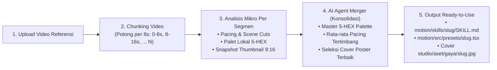

# Arsitektur & Alur Produksi Video Animasi (Cheat Clip & Motion)

> **Kredit & Lisensi:**  
> Dikembangkan oleh **Bayunity** untuk kebutuhan internal **BRKH Studio**.  
> Template dan basis arsitektur oleh **Maliki Saputra (@malikisaputra)** — [https://malikisaputra.biz.id](https://malikisaputra.biz.id).  
> Berdasarkan Lisensi Nonkomersial Maliki Studio 1.0 (`alat/LISENSI.md`). Dilarang keras dijual ulang.

---

## 1. Filosofi Inti: AI Agent Sebagai "Whiteboard Kosong" yang Diarahkan

Dalam ekosistem **Cheat Clip & Motion**, AI Agent bukanlah entitas otonom tanpa batas yang dibiarkan mengarang bebas (*halusinasi*). 

```
+-----------------------------------------------------------------------------------+
|                        AI AGENT = WHITEBOARD KOSONG (TABULA RASA)                 |
|                                                                                   |
|  Tanpa instruksi rel yang ketat, AI Agent tidak mengetahui:                       |
|  - Siapa nama tokoh dan bagaimana pakaian konsistennya.                           |
|  - Di mana latar tempatnya (misal: Warung Mbok Jum di Desa Siforejo).            |
|  - Berapa jumlah frame animasi stop-motion yang pas untuk ritme naskah.           |
|                                                                                   |
|  Oleh karena itu, sistem menyediakan FRAMEWORK 5 PILAR sebagai "Spidol Pengarah"  |
|  untuk mengisi whiteboard kosong tersebut menjadi instruksi matang & terukur.     |
+-----------------------------------------------------------------------------------+
```

### Pemisahan Tanggung Jawab Dua Tahap (*Decoupled Two-Stage Architecture*)
1. **User Mesin (`studio.py` / Web UI):**  
   Hanya memasukkan bahan mentah (*raw input*): konsep cerita, nama tokoh (Tokoh 1 & 2), dan preferensi latar/template. User tidak dibebani kerumitan kode render, rasio frame, atau CSS/SVG.
2. **Tahap 1: AI Agent (Perencana & Kompilator Hulu):**  
   Mengarahkan papan tulis kosong melalui 5 pilar analisa hingga menghasilkan satu cetak biru terstruktur (`alur-produksi.json`).
3. **Tahap 2: AI Agent CLI (Eksekutor Hilir - `agy` / `claude`):**  
   Membaca cetak biru matang dari Tahap 1, menerapkan aturan `SKILL.md`, menginjeksi data ke `VideoAnimasi.tsx`, lalu merender file `.mp4` secara deterministik tanpa interpretasi ulang.

---

## 2. Diagram Alur Sistem Terpadu (Mermaid)

```mermaid
flowchart TD
    %% Tahap Input
    User["User Mesin (studio.py Web UI)"] -->|"Input Raw: Narasi/VO, Konsep, Pilihan Tokoh & Gaya"| AgentPlan["AI Agent (Whiteboard Kosong)"]

    %% Kotak Pengarah 5 Pilar Analisa
    subgraph KotakPengarah ["Framework Pengarah AI Agent (5 Pilar Analisa Berantai)"]
        K1["1. Analisa Konsep & Tema<br/>- Validasi universe visual (Desa/Kota/Sci-Fi)<br/>- Kecocokan tone dengan narasi VO"]
        K2["2. Analisa Storyboard (5 Elemen Kunci)<br/>- 1. Latar Tempat (Environment)<br/>- 2. Aset & Properti (Kopi, Kursi, dsb)<br/>- 3. Jumlah Tokoh (1 atau 2 Karakter)<br/>- 4. Konsistensi Visual (Warna/Ciri Khusus)<br/>- 5. Konsep Adegan (Callout & Balon Dialog)"]
        K3["3. Pencocokan Audio & Template Global<br/>- Kalibrasi durasi adegan (~3.5s - 8s)<br/>- Sinkronisasi DNA ekstrak video referensi"]
        K4["4. Perintah Adegan Animasi<br/>- Penentuan pose gerak & arah tatap<br/>- Rumus Stepped Frame Stop-Motion (8-12 fps)"]
        K5["5. Persiapan Mesin Kode<br/>- Pemetaan props VideoAnimasi.tsx<br/>- Isolasi ruang kerja sesi produksi"]

        K1 --> K2
        K2 --> K3
        K3 --> K4
        K4 --> K5
    end

    AgentPlan --> KotakPengarah

    %% Output Jembatan
    KotakPengarah --> AgentCompile["AI Agent (Kompilasi Paket Mandiri)"]
    AgentCompile --> Paket["Output Jembatan Terstruktur: alur-produksi.json<br/>(Gabungan DNA Template + Adegan Raw User + Audio Alignment)"]

    %% Ruang Kerja Sesi Terisolasi
    subgraph RuangSesi ["Ruang Kerja Sesi Terisolasi (Sandbox)"]
        Paket --> SesiDir["Folder: motion/temp/sesi_ID/"]
        SesiDir --> FCode["kode/alur-produksi.json"]
        SesiDir --> FAud["audio/vo_chunks.wav"]
        SesiDir --> FFrm["frames/ (Encoding & QA Cache)"]
    end

    %% Tahap Eksekusi CLI
    SesiDir -->|"Data Matang Diteruskan"| AgentCLI["AI Agent CLI Eksekutor (agy / claude)"]
    Skill["SKILL.md & Standar Efisiensi RAM"] -.->|"Pedoman Wajib"| AgentCLI
    AgentCLI --> RemotionEngine["Remotion Native Engine (VideoAnimasi.tsx)<br/>- Render Native Vector/Canvas di Headless Chromium<br/>- Stepped Frame: Math.floor(frame / step) * step"]

    %% Hasil Akhir & Siklus Pembersihan
    RemotionEngine --> OutputVideo(["Hasil Akhir: File Video .MP4 di motion/hasil/"])
    RemotionEngine --> KeyframeQA(["1 Keyframe Thumbnail per Adegan (Katalog Visual QA)"])
    RemotionEngine --> AutoPurge{"Status Render Berhasil?"}

    AutoPurge -->|Ya (Exit Code 0)| PurgeAction["Auto-Purge 99% Cache Mentah<br/>(Hapus seluruh folder frames/ & audio/ sementara)"]
    AutoPurge -->|Opsi Toggle Aktif| KeepFrames["Mode Animator / Debug (Pertahankan Frame)"]
```

---

## 3. Rincian 5 Pilar Pengarah Storyboard (Sesuai Diagram Asli)

Sesuai diagram arsitektur asli, AI Agent memproses naskah mentah melalui **Analisa Konsep & Tema** dan **Analisa Storyboard (5 Pilar Kunci)**:

```
+-----------------------------------------------------------------------------------+
| 1. ANALISA KONSEP & TEMA                                                          |
|    - Jenis gaya visual template (toon-desa, toon-3d, stickman, anime-cel, dll.)   |
|    - Kecocokan narasi dan voice over:                                             |
|      * Mode A: Narator Utama / Voiceover (Visual menceritakan kejadian narasi)    |
|      * Mode B: Dialog Sketsa (Dubbing percakapan langsung antar-tokoh)            |
+-----------------------------------------------------------------------------------+
| 2. ANALISA STORYBOARD (5 PILAR)                                                   |
|    1. Latar: Tempat spesifik adegan (misal: Pelataran Masjid Baitussalam)         |
|    2. Aset: Objek interaksi pendukung (misal: motor raib, buku catatan, kopi)     |
|    3. Tokoh ada berapa: Fleksibel sesuai adegan (0 tokoh, 1 tokoh, atau 2+ tokoh) |
|    4. Visualnya seperti apa agar konsisten: Palet warna, pakaian, & proporsi tokoh|
|    5. Konsep: Apa yang diperagakan visual untuk merekonstruksi narasi narator     |
|               (Balon dialog OFF jika mode narator; Balon ON hanya jika dialog)    |
+-----------------------------------------------------------------------------------+
```

### Tabel Parameter Storyboard:

| No | Elemen Analisa | Parameter yang Dikunci Sistem | Contoh Penerapan (Kasus Pak Agus) |
|---|---|---|---|
| **1** | **Latar Tempat (*Environment*)** | Nama latar, detail suasana, palet warna langit/lingkungan | *Pelataran Masjid Baitussalam (Kubah, Halaman Parkir)* |
| **2** | **Aset & Properti** | Objek kunci yang memperkuat penceritaan | *Tempat Parkir Kosong, Sandal Masjid, Catatan Pak RT* |
| **3** | **Tokoh Ada Berapa** | Fleksibel: 0 (b-roll latar/aset), 1 (monolog/panik), 2 (interaksi) | *Scene 1: Pak Agus sendiri (1); Scene 2: Pak Agus + Pak RT (2)* |
| **4** | **Konsistensi Visual** | Palet 5 HEX dominan, ciri pakaian & warna kulit tokoh | *Pak Agus: Baju Koko Cokelat `#78350F`; Pak RT: Peci Hitam `#0F172A`* |
| **5** | **Konsep & Rekonstruksi** | Aksi peraga yang menghidupkan narasi voiceover tanpa balon komik | *Visual merekonstruksi Pak Agus panik melapor ke Pak RT yang menyimak, tanpa balon obrolan menutupi layar* |

> [!NOTE]
> **Aturan Balon Obrolan (*Speech Bubble*):**
> - **Mode Narator Tunggal (Umum):** `tampilkan_balon: false`. Audio diisi suara narator, sedangkan visual memperagakan cerita. Layar bersih, luas, fokus pada latar dan aksi tokoh. Subtitle narasi mengalir di bawah.
> - **Mode Dialog Komik (Khusus):** `tampilkan_balon: true`. Hanya digunakan jika naskah secara eksplisit merupakan sketsa percakapan bolak-balik dengan audio suara karakter langsung.

---

## 4. Penegasan Arsitektur: Native Vector/Canvas Remotion vs Cache Folder `frames/`

> [!IMPORTANT]
> **PENEGASAN TEKNIS AGAR TIDAK SALAH PAHAM:**  
> Mesin `VideoAnimasi.tsx` adalah **Native Vector & Canvas 2D Engine**, BUKAN sistem pemutar urutan gambar sprite eksternal (*image sequence player*).

### A. Bagaimana Efek Stop-Motion Diproduksi di `VideoAnimasi.tsx`?
Remotion merender seluruh elemen visual (karakter toon, latar warung desa, balon dialog pop-up) secara **native di memori browser headless (Chromium)** menggunakan React, Canvas 2D API, dan rumus matematika *stepped frame*:

```typescript
// Logika Stepped Frame Deterministik di VideoAnimasi.tsx:
// Basis proyek: 30 FPS. Target stop-motion: 10–12 FPS.
const stopMotionFps = 12;
const step = Math.round(FPS / stopMotionFps); // step = 2 atau 3 frame per tick
const steppedFrame = Math.floor(frame / step) * step;
const t = steppedFrame / FPS; // Waktu lompat (stepped time) yang menghasilkan ilusi stop-motion
```
Artinya:
- **TIDAK PERLU** men-generate 720 file gambar PNG di luar sebelum video dirender.
- Semua gerakan (tangan mengayun, mulut komat-kamit bicara, balon pop-up, uap kopi) dihitung langsung secara matematis di dalam memori React saat rendering.

### B. Lalu untuk Apa Sub-Folder `frames/` di Direktori Sesi?
Sub-folder `frames/` di dalam sesi kerja **BUKAN** aset input untuk dibaca oleh Remotion, melainkan:
1. **Wadah Output Snapshot Visual QA:** Tempat Remotion menyimpan hasil `npx remotion still --frame=X` (`qa_frame_0.png`) untuk diinspeksi oleh user di Web UI sebelum full render.
2. **Buffer Cache Encoding FFmpeg:** Tempat penyimpanan frame sementara jika FFmpeg atau Chromium memerlukan ruang buffer perantara selama proses rendering video panjang sebelum di-muxing menjadi satu berkas `.mp4`.

---

## 5. Konsep "Satu Ruangan Produksi" (*Isolated Session Sandbox*)

Untuk mencegah file produksi berserakan dan saling menimpa, setiap proses produksi dibungkus dalam satu wadah direktori sesi yang terisolasi:

```
motion/temp/sesi_<timestamp>_<slug>/
├── kode/
│   ├── alur-produksi.json       # Cetak biru final hasil analisa AI Agent
│   └── remotion-props.json      # Props injeksi untuk VideoAnimasi.tsx
├── audio/
│   ├── vo_narasi.wav            # Audio narasi master
│   └── timestamps.json          # Hasil audio-script alignment kata per kata
├── frames/                      # Wadah cache encoding FFmpeg & snapshot Visual QA
│   ├── qa_frame_adegan_1.png    # Snapshot bukti keyframe
│   └── ...                      # Buffer intermediate encoding (jika ada)
└── status.json                  # Log status proses render (progress 0 - 100%)
```

---

## 6. Manajemen Siklus Hidup Aset & Kebersihan Ruang Disk (*Cache Lifecycle*)

### Masalah Volume Gambar Sementara
- Pada proses encoding video 1 menit 1080x1920, buffer frame encoding dan audio sementara dapat memakan **~300 MB s.d. 700 MB**.
- Jika 10 kali render berturut-turut ditinggalkan tanpa pembersihan, hard disk akan terbuang sia-sia sebesar **~5 GB hingga 7 GB**.

### Tiga Lapisan Solusi Pembersihan Otomatis (*Auto-Purge & Housekeeping*)

1. **Auto-Purge on Success (Hapus Otomatis 99% Pasca-Render):**
   - Setelah proses render Remotion selesai sukses (berstatus exit code 0 dan file `.mp4` valid terbit di `motion/hasil/`), sistem secara otomatis **menghapus (*unlink*) seluruh isi sub-folder `frames/` dan `audio/`** pada sesi tersebut.
   - Ruang disk langsung kembali lega seketika.

2. **Penyelamatan 1 Keyframe per Adegan (Katalog Visual QA):**
   - Sistem **hanya menyisakan 1 frame representatif (keyframe thumbnail)** untuk setiap adegan.
   - Keyframe ini disimpan berdampingan dengan file `.mp4` (ukuran total < 1 MB) sebagai arsip visual untuk kartu riwayat di Studio dan bukti kepatuhan *Visual QA*.

3. **Auto-Sweep Saat Studio Startup (TTL 24 Jam):**
   - Jika proses render sebelumnya terhenti di tengah jalan karena listrik padam atau studio dimatikan mendadak, server `studio.py` saat pertama kali dinyalakan akan memindai folder `motion/temp/` dan otomatis menghapus sesi yang berumur lebih dari 24 jam (*stale temporary files*).

4. **Sakelar Opsi: Mode Animator / Debug:**
   - Disediakan toggle di antarmuka Pengaturan:
     > `[ ] Pertahankan frame gambar mentah (Mode Animator / Debug)`
   - Jika dimatikan (bawaan): Pembersihan berjalan otomatis.
   - Jika diaktifkan: Folder `frames/` tetap dipertahankan bagi pengguna yang ingin mengekspor frame ke Adobe After Effects atau Photoshop.

---

## 7. Spesifikasi Skema Jembatan Terstruktur (`alur-produksi.json`)

File jembatan ini menjadi satu-satunya sumber kebenaran (*single source of truth*) yang dikonsumsi oleh `VideoAnimasi.tsx`:

```json
{
  "versi": "2.0.0",
  "id_sesi": "sesi_1795296000_desa_siforejo",
  "metadata": {
    "judul": "Hutang Rokok yang Terlupakan",
    "rasio": "9:16",
    "gaya_visual_slug": "toon-desa",
    "stop_motion_fps": 12,
    "palet_warna": ["#1e293b", "#38bdf8", "#22c55e", "#f59e0b", "#ef4444"]
  },
  "audio": {
    "file_master": "audio/vo_narasi.wav",
    "durasi_total_detik": 14.5
  },
  "adegan": [
    {
      "id": 1,
      "judul": "Budi Mampir Warung Siforejo",
      "durasi_detik": 3.5,
      "latar": {
        "id": "warung-desa",
        "nama": "Warung Makan Desa (Siforejo / Spanduk & Kopi)"
      },
      "callout_badge": "📍 WARUNG SIFOREJO",
      "tokoh_1": {
        "nama": "Budi",
        "pose": "Duduk Santai",
        "properti": "Kopi Tubruk"
      },
      "tokoh_2": null,
      "dialog": {
        "karakter": "Budi",
        "teks": "Mbok, kopi tubruk satu ya!"
      },
      "narasi_vo": "Sore itu, Budi mampir ke warung makan Mbok Jum di pinggir desa Siforejo untuk ngopi santai."
    },
    {
      "id": 2,
      "judul": "Ridwan Datang Menagih",
      "durasi_detik": 4.0,
      "latar": {
        "id": "kursi-bambu",
        "nama": "Kursi Bambu Depan Warung"
      },
      "callout_badge": "📍 DEPAN WARUNG",
      "tokoh_1": {
        "nama": "Budi",
        "pose": "Menoleh Terkejut",
        "properti": "Gelas Kopi"
      },
      "tokoh_2": {
        "nama": "Ridwan",
        "pose": "Berdiri Tegak",
        "properti": "Buku Catatan"
      },
      "dialog": {
        "karakter": "Ridwan",
        "teks": "Bud, rokok yang kemarin jangan lupa ya."
      },
      "narasi_vo": "Belum sempat kopi diseruput, Ridwan tiba-tiba muncul dari balik pohon dengan raut muka menagih."
    }
  ]
}
```

---

## 8. Kontrak Perilaku Agen CLI (`agy` / `claude`)

1. **Dilarang Mengubah Naskah di Tahap Hilir:**  
   AI Agent CLI tidak boleh menambahkan adegan baru atau mengganti nama tokoh yang sudah disepakati di `alur-produksi.json`.
2. **Efisiensi Memori Ketat:**  
   Konsumsi RAM selama kompilasi dan render Remotion wajib berada di bawah **600 MB**, dengan menggunakan kompresi SVG aman dan pembersihan buffer canvas.
3. **Kepatuhan Terhadap Keyframe QA:**  
   Sebelum merender keseluruhan video secara penuh, CLI wajib memastikan snapshot *Keyframe QA* adegan pertama berhasil diekstrak dan valid secara visual.

---

## 9. Mode Produksi Cerita & Floating Real-Time Diagnostic Console

### 9.1 Empat Mode Produksi Cerita (Studio UI)
Pengguna dapat memilih arketipe cerita di Studio Web sebelum AI Agent menganalisa naskah:
1. **🎙️ Mode Narator & Reka Visual (Default):**
   - Suara narator membawakan naskah/VO.
   - Tokoh dan latar merekonstruksi adegan secara hidup.
   - **Balon obrolan dimatikan (OFF)** agar layar bersih dari bubble teks komik.
2. **💬 Mode Sketsa Dialog Interaktif:**
   - Obrolan timbal balik 2 tokoh secara langsung.
   - **Balon obrolan adaptif menyala (ON)** dengan penempatan otomatis di atas kepala tokoh yang sedang berbicara.
3. **👤 Mode Monolog / POV Curhat:**
   - 1 Tokoh menghadap ke arah audiens/kamera, membawakan cerita atau opini secara ekspresif.
4. **📊 Mode Infografis Kinetik:**
   - Tokoh presenter/stickman memandu penjelasan data, grafik, dan teks sorot kinetik dinamis.

### 9.2 Floating Diagnostic Console & Human Error Translator
Widget mengambang (*floating pill & panel*) di pojok kanan bawah Studio Web UI:
- **Status Real-Time:** Menampilkan indikator dot dinamis (`IDLE` hijau, `RUNNING` biru berkedip, `ERROR` merah berdenyut).
- **Penerjemah Bahasa Manusia (*Human-Friendly Error Translator*):**
  Mengubah pesan galat teknis yang membingungkan menjadi diagnosa ramah dan panduan solusi praktis:
  - **Kuota Habis (403/429/RESOURCE_EXHAUSTED):** Diterjemahkan sebagai *"Batas Kuota Gemini API Habis"* lengkap dengan instruksi menambah rolling key.
  - **FFmpeg Hilang (ENOENT/ffmpeg not found):** Diterjemahkan sebagai *"FFmpeg Belum Terpasang"* dengan perintah instalasi cepat via `winget`.
  - **Memori Habis (JavaScript heap out of memory):** Diterjemahkan sebagai *"Memori RAM Penuh"* dengan saran rasio vertikal dan pemangkasan adegan.
  - **Durasi Desync:** Diterjemahkan sebagai *"Naskah Melebihi Durasi Audio"* dengan tombol pintas *"⚡ Sesuaikan ke Akhir Audio"*.
- **Auto-Popup:** Panel diagnostik otomatis terbuka ketika terjadi kendala agar pengguna segera mengetahui penyebab dan solusinya tanpa harus membuka terminal hitam.

---

## 10. Pipeline Ekstraksi Gaya Video: Chunking 8 Detik & AI Merger (Map-Reduce)

Untuk memastikan gaya visual dari video referensi (TikTok, Reels, Shorts) dapat diekstrak secara presisi tanpa ada detail transisi dan pacing yang terlewat, sistem menggunakan arsitektur **Map-Reduce Time-Sliced**:



### Rincian Tahap Chunking & Merger:
1. **Segmentasi Waktu (Window 8 Detik):** Video referensi durasi $D$ dipotong menjadi $N = \lceil D / 8.0 \rceil$ langkah.
2. **Analisis Mikro Per Segmen (Step 1..N):** Setiap segmen dianalisis individual oleh AI Agent, menghasilkan `step_XX_metrics.json` dan snapshot 9:16 `studio/aset/gaya/segments/<slug>_step_XX.jpg`.
3. **Konsolidasi / The Merger:** AI Agent menggabungkan seluruh file segmen menjadi 1 file `metrics.json` konsolidasi dan menyusun tabel ringkasan di `SKILL.md` (Bagian 6).
4. **Registrasi Otomatis:** Template Remotion instan muncul di galeri Studio tanpa perlu me-restart server.

---

## 11. Pipeline Canvas Gemini: Generator Naskah Video Pendek, TTS & Visual Bible

Integrasi hulu naskah kini mengarah ke aplikasi Canvas Gemini terbaru:  
🔗 **URL Resmi:** `https://share.gemini.google/NFulYmtV6Anl`

### Format Output yang Didukung:
1. **Format 1 (Naskah Tag Latar):**
   Format teks standar `[ADEGAN X | LATAR: ...]`, langsung diparsing menjadi adegan visual terpisah di Storyboard.
2. **Format 2 (Naskah Bersih TTS):**
   Teks audio bebas timestamp dan kurung siku, siap ditempel ke ElevenLabs atau Google AI Studio TTS.
3. **Format 3 (Visual Bible & Konsistensi Tokoh):**
   Kamus visual yang mengunci detail pakaian tokoh, warna dinding latar, dan pencahayaan agar 100% konsisten antar-adegan.
4. **Format 4 (Manifest Storyboard JSON):**
   Format deterministik JSON (`adegan_storyboard`) yang dapat diimpor langsung ke tab Motion Studio via **📥 Impor dari Canvas Gemini (1-Klik)**.

---
*Dokumen ini merupakan pedoman resmi alur produksi video animasi Cheat Clip & Motion. Seluruh modifikasi kode di masa mendatang wajib merujuk pada standar arsitektur di atas.*
