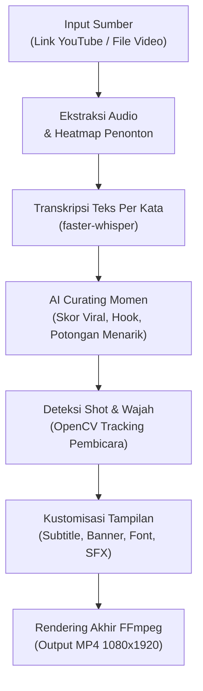
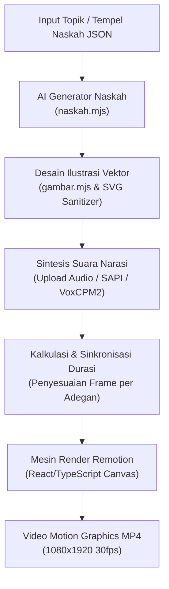
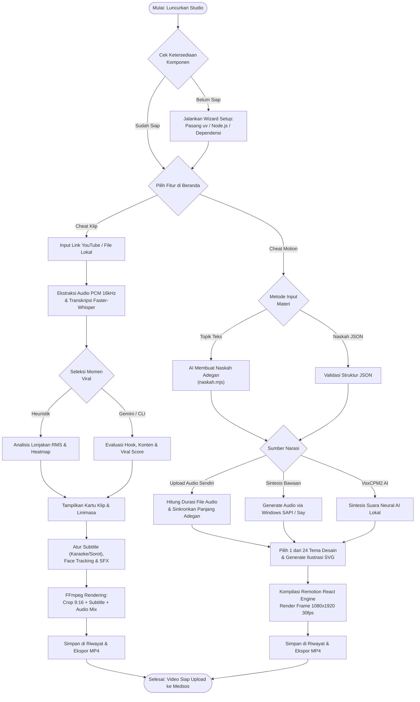

# Panduan & Dokumentasi Alur Kerja Cheat Clip and Motion (A sampai Z)

Dokumentasi resmi alur kerja (*end-to-end workflow*) aplikasi **Cheat Clip and Motion** secara mendalam dan terstruktur langkah demi langkah (*step-by-step*), mulai dari instalasi awal, arsitektur teknis, pemrosesan video klip, pembuatan motion graphics, hingga ekspor akhir.

---

## Daftar Isi
1. [A. Gambaran Umum & Filosofi Sistem](#a-gambaran-umum--filosofi-sistem)
2. [B. Arsitektur Teknis Aplikasi](#b-arsitektur-teknis-aplikasi)
3. [C. Persyaratan Sistem & Instalasi (Setup Awal)](#c-persyaratan-sistem--instalasi-setup-awal)
4. [D. Konfigurasi AI & Engine Suara](#d-konfigurasi-ai--engine-suara)
5. [E. Alur Kerja Fitur "Cheat Klip" (Video Panjang ke 9:16)](#e-alur-kerja-fitur-cheat-klip-video-panjang-ke-916)
6. [F. Alur Kerja Fitur "Cheat Motion" & Studio Animasi Bergerak](#f-alur-kerja-fitur-cheat-motion--studio-animasi-bergerak)
7. [G. Fitur Kolaborasi Hibrid (Klip + Motion)](#g-fitur-kolaborasi-hibrid-klip--motion)
8. [H. Fitur Tools Mandiri: Ekstrak Gaya Video Global](#h-fitur-tools-mandiri-ekstrak-gaya-video-global)
9. [I. Struktur Direktori & Penyimpanan Berkas](#i-struktur-direktori--penyimpanan-berkas)
10. [J. Diagram Alur Kerja Lengkap (Mermaid Flowchart)](#j-diagram-alur-kerja-lengkap-mermaid-flowchart)
11. [Z. Pemecahan Masalah (Troubleshooting & FAQ)](#z-pemecahan-masalah-troubleshooting--faq)

---

## A. Gambaran Umum & Filosofi Sistem

**Cheat Clip and Motion** adalah aplikasi workstation konten video desktop yang dirancang dengan 3 prinsip utama:
1. **100% Local-First & Privasi Terjaga:** Seluruh pemrosesan video, transkripsi audio, dan render grafis dieksekusi langsung di mesin lokal pengguna. Berkas video Anda tidak pernah diunggah ke cloud pihak ketiga.
2. **BYOK & BYOS (Bawa Akun & Kuncimu Sendiri):** Pengguna memiliki kendali penuh atas mesin AI:
   - Mode gratis tanpa kuota (*Lokal Heuristik*).
   - Mode API resmi gratis/berbayar (*Google Gemini API*, *OpenAI / Ollama*).
   - Mode CLI Langganan (*Claude Pro/Max* via Claude Code, *ChatGPT Plus/Pro* via Codex CLI, dan *OpenCode*).
3. **Tanpa Watermark & Bebas Biaya Langganan Tambahan:** Hasil ekspor video sepenuhnya menjadi hak milik kreator.

---

## B. Arsitektur Teknis Aplikasi

Aplikasi dibangun dengan arsitektur modular yang menggabungkan Python, Node.js, WebKit/WebView2, dan FFmpeg:

```
+-------------------------------------------------------------------------+
|                  GUI Desktop (PyWebView / Browser Local)                |
|                    HTML5 + CSS3 + Vanilla JS UI (SPA)                   |
|                        http://127.0.0.1:8787                            |
+------------------------------------+------------------------------------+
                                     | (REST API & Server Sent Events)
+------------------------------------v------------------------------------+
|               Studio Server (Python 3.10-3.12 / studio.py)              |
|        - Job Queue Manager (Eksekusi 1 tugas intensif bergantian)       |
|        - Autentikasi asal aman (Origin protection / anti-CSRF)          |
|        - Parser konfigurasi lokal (pengaturan.env)                      |
+-------------------+--------------------------------+--------------------+
                    |                                |
+-------------------v---------------+  +-------------v--------------------+
|      Sub-Engine CHEAT KLIP        |  |     Sub-Engine CHEAT MOTION      |
|           (klip.py)               |  |     (buat.mjs + Remotion)        |
|-----------------------------------|  |----------------------------------|
| • yt-dlp: Unduh YouTube 1080p     |  | • naskah.mjs: Generator Naskah AI|
| • FFmpeg: Ekstraksi audio PCM     |  | • gambar.mjs: Desain SVG Dinamis |
| • faster-whisper: Transkripsi AI  |  | • Windows SAPI / macOS say /     |
| • OpenCV: Deteksi wajah & kamera  |  |   VoxCPM2 (Neural TTS)           |
| • ASS Subtitle Generator dinamis  |  | • Remotion React/TS Video Engine |
| • FFmpeg Render: Crop 9:16 + SFX  |  | • FFmpeg MP4 1080x1920 30fps     |
+-----------------------------------+  +----------------------------------+
```

---

## C. Persyaratan Sistem & Instalasi (Setup Awal)

### 1. Spesifikasi Perangkat
- **Sistem Operasi:** Windows 10/11 (64-bit) atau macOS (Intel / Apple Silicon).
- **RAM:** Minimal 8 GB (Disarankan 16 GB untuk proses Whisper & Remotion bersamaan).
- **Ruang Kosong Harddisk:** Minimal 5 GB – 10 GB untuk cache model AI, font, dan hasil render video.
- **Node.js (Wajib untuk fitur Motion):** Node.js versi LTS (v18 ke atas) dari [nodejs.org](https://nodejs.org).

### 2. Langkah Instalasi Langkah demi Langkah

#### Jalur Windows:
1. Ekstrak folder proyek ke lokasi penyimpanan yang stabil (contoh: `D:\berjan\cheat clip motion`).
2. Klik ganda file:
   ```cmd
   Pasang Cheat Clip and Motion (Windows).bat
   ```
3. Skrip PowerShell (`pasang-windows.ps1`) akan berjalan otomatis:
   - Memeriksa dan memasang `uv` (manajer paket Python berkecepatan tinggi).
   - Menyiapkan environment isolated untuk `studio.py`.
   - Membuat pintasan resmi di **Desktop** dan **Start Menu** menggunakan executable windowless `uvw.exe`.
   - Membuka jendela aplikasi desktop mandiri berbasis Microsoft Edge WebView2.

#### Jalur macOS:
1. Klik ganda file:
   ```bash
   Pasang Cheat Clip and Motion.command
   ```
2. Aplikasi `.app` akan otomatis terpasang di folder `/Applications` dan muncul di Launchpad/Spotlight.

#### Jalur Manual (CLI):
```bash
# Jalankan jendela desktop mandiri
uv run studio/studio.py

# Atau jalankan langsung di browser utama Anda
uv run studio/studio.py --browser
```

---

## D. Konfigurasi AI & Engine Suara

Sebelum memulai pembuatan video, buka tab **Pengaturan AI** di sidebar aplikasi:

### 1. Memilih Mesin AI
| Pilihan Mesin | Cara Setup | Kelebihan | Rekomendasi Penggunaan |
|---|---|---|---|
| **Lokal (Heuristik)** | Siap pakai tanpa konfigurasi | 100% offline, tidak butuh kunci atau internet | Saat kuota internet terbatas |
| **Google Gemini** | Dapatkan API Key gratis di [Google AI Studio](https://aistudio.google.com/apikey) lalu tempel | Sangat cepat, kuota gratis melimpah, analisis konteks cerdas | **Sangat Direkomendasikan** untuk sebagian besar pengguna |
| **Ollama (Lokal)** | Pasang [Ollama](https://ollama.com), unduh model (mis. `gemma3:4b` atau `llama3`) | 100% privat dan offline, tanpa biaya | Pengguna dengan PC berspesifikasi tinggi / GPU diskrit |
| **Langganan CLI** | Klik tombol *Pasang & Masuk Akun* untuk Antigravity (`agy`), Claude Code (`claude auth login`), atau Codex (`codex login`) | Menggunakan kuota langganan aktif tanpa membeli token API tambahan | Bagi pemilik langganan aktif Google Antigravity, ChatGPT Plus, atau Claude Pro |

### 2. Monitor Kuota Realtime Antigravity CLI ("Usage Models")
Saat Anda memilih mode **Antigravity CLI** di Pengaturan AI, Studio secara otomatis mengaktifkan widget pemantau kuota token realtime:
- **Koneksi Daemon Lokal:** Studio membaca port dan token otentikasi internal dari `~/.gemini/antigravity/daemon/hub_*.json` (Connect-RPC service `RetrieveUserQuotaSummary`).
- **Dua Lapisan Kuota:**
  - **Weekly Limit Remaining (Batas Mingguan):** Menampilkan sisa kapasitas token mingguan (periode 7 hari) dan estimasi hari/jam reset.
  - **Five Hour Limit Remaining (Batas 5 Jam):** Menampilkan persentase batas kecepatan (velocity limit) yang pulih otomatis setiap 5 jam.
- **Pemisahan Model:** Menampilkan metrik terpisah untuk **Gemini Models** dan **Claude & GPT Models**.
- **Tombol Segarkan (↻):** Memungkinkan pengecekan kuota langsung kapan saja tanpa perlu me-restart aplikasi.

### 3. Konfigurasi Suara Narator (Untuk Motion)
- **Suara Bawaan Sistem:**
  - Windows: Memanfaatkan Microsoft Speech Synthesizer (SAPI / OneCore). Jika suara "Microsoft Andika" terpasang, narasi otomatis berbahasa Indonesia fasih.
  - macOS: Memanfaatkan perintah `say` bawaan dengan profil suara berkualitas tinggi (seperti *Damayanti*).
- **VoxCPM2 (Neural AI TTS Lokal - Opsional):**
  - Klik *Pasang suara AI (±5 GB)* untuk mengunduh model neural OpenBMB.
  - Mendukung 3 mode: *Netral*, *Desain Karakter Suara*, dan *Voice Cloning* (mengkloning suara sendiri dari sampel WAV 10–20 detik berizin).
- **Upload Audio Sendiri (Fitur Audio Kustom):**
  - Anda dapat mengunggah file rekaman voice-over pribadi (`.mp3`, `.wav`, `.m4a`). Sistem akan otomatis menyesuaikan durasi tiap adegan dengan panjang audio Anda.

---

## E. Alur Kerja Fitur "Cheat Klip" (Video Panjang ke 9:16)

> [!NOTE]
> **Status Fitur (Tahap Pengembangan):**
> Mode Klip Video di dalam aplikasi Cheat Studio saat ini sedang dalam pembaruan arsitektur dan dinonaktifkan sementara. Untuk memotong video panjang menjadi klip vertikal, silakan gunakan **aplikasi klip terpisah** yang dapat diunduh/dipasang melalui repositori resmi:
> 👉 [https://github.com/Bayunity-Brkhstd/clip](https://github.com/Bayunity-Brkhstd/clip)

Fitur ini mengubah video horizontal (16:9) seperti podcast, wawancara, presentasi, atau seminar menjadi beberapa klip vertikal siap posting di TikTok, Instagram Reels, dan YouTube Shorts.



### Langkah demi Langkah:

#### Step 1: Memasukkan Video Sumber
1. Buka menu **Klip** di sidebar.
2. Tentukan sumber video:
   - **Tempel URL YouTube:** Aplikasi akan mengunduh video otomatis dengan resolusi optimal (hingga 1080p) via `yt-dlp`.
   - **Pilih / Seret File Lokal:** Tarik file format `.mp4`, `.mov`, atau `.mkv` dari file explorer Anda ke area input.

#### Step 2: Konfigurasi Analisis
- **Target Durasi:** Tentukan batas durasi tiap klip (15 detik, 30 detik, atau 60 detik).
- **Jumlah Klip:** Atur berapa banyak klip terbaik yang ingin dicari (1 hingga 30 klip).
- **AI Pemilih Momen:** Pilih mesin yang diinginkan (Lokal, Gemini, Ollama, atau CLI).
- **Momen yang Dicari (Opsional):** Tulis instruksi kontekstual (contoh: *"Cari argumen paling kontroversial"*, *"Ambil tips bisnis praktis"*, atau *"Momen paling lucu"*).
- **Rentang Khusus (Opsional):** Batasi menit awal dan akhir video yang ingin dipindai (misal: `10:00-25:00`).

#### Step 3: Proses Analisis Otomatis
Klik tombol **"Cari Momen"**. Di balik layar, sistem melakukan:
1. **Analisis Energi Suara:** Menghitung Root-Mean-Square (RMS) per detik audio untuk menemukan lonjakan antusiasme pembicara.
2. **Ekstraksi YouTube Heatmap:** Membaca grafik momen paling sering diputar ulang oleh penonton (jika bersumber dari YouTube).
3. **Transkripsi Berbasis Whisper:** Audio diubah menjadi teks kata per kata beserta stempel waktu milidetik.
4. **Evaluasi AI:** AI menganalisis transkrip untuk mencari struktur Hook $\rightarrow$ Isi $\rightarrow$ Payoff, memberikan skor viralitas (1–100), membuat judul banner penarik perhatian, dan menyusun caption postingan.

#### Step 4: Peninjauan & Pemilihan Klip
Setelah analisis selesai, layar menyajikan:
- **Linimasa Interaktif:** Menampilkan grafik energi audio dan sebaran momen yang terdeteksi.
- **Daftar Kartu Klip:** Setiap kartu menampilkan skor viral, durasi, cuplikan transkrip, serta judul yang dapat diedit langsung.
- Beri tanda centang pada klip-klip yang ingin Anda jadikan video final.

#### Step 5: Pengaturan Studio Render & Framing
Di panel sebelah kanan, sesuaikan tampilan visual klip:
- **Preset Subtitle Dinamis:**
  - *Merek Cheat:* Tipografi modern warna Cyan dengan animasi kata aktif.
  - *Sorot Kuning:* Gaya Alex Hormozi dengan penyorot kata penting warna kuning terang.
  - *Pop Kapital:* Huruf kapital tebal dengan animasi memantul (*bounce*).
  - *Komik:* Font ekspresif bergaya komik.
  - *Karaoke:* Pergantian warna suku kata yang sinkron secara presisi dengan suara pembicara.
- **Fokus Kamera & Pelacakan Wajah (Face Tracking):**
  - *Otomatis (Wajah):* Algoritma OpenCV memindai pergeseran adegan kamera (*shot change detection*) dan melacak wajah pembicara di setiap adegan, lalu memotong area 9:16 secara dinamis (*smooth pan*).
  - *Manual:* Pilihan fokus statis (Tengah, Kiri, atau Kanan).
  - *Tata Letak Facecam / Split Screen:* Menampilkan wajah pembicara di atas dan layar presentasi di bawah.
- **Audio & Efek:**
  - Musik latar ceria/santai dengan auto-ducking volume.
  - Efek suara *Whoosh / Ding* pembuka pada detik pertama (*Hook SFX*).

#### Step 6: Render & Unduh
Klik tombol **"Render Klip Terpilih"**.
- Mesin FFmpeg mengeksekusi cropping, penataan subtitle berbasis file `.ass` berkecepatan tinggi, audio filter, dan penggabungan grafik.
- Hasil video MP4 tersimpan di direktori proyek dan dapat langsung diunduh ke folder `Downloads` hanya dengan satu klik.

---

## F. Alur Kerja Fitur "Cheat Motion" (Naskah ke Motion Graphics)

Fitur ini membuat video animasi grafis 9:16 dari nol berdasarkan topik naskah, lengkap dengan narasi suara, ilustrasi ikonik, subtitle kinetik, dan transisi panggung.



### Langkah demi Langkah:

#### Step 1: Menentukan Materi & Mode Input
Pilih salah satu metode input naskah di aplikasi:
- **Aplikasi Canvas Gemini (Akses Cepat di Beranda & 1-Klik Impor):**
  - Klik kartu *Generator Naskah Video Pendek, TTS & Visual Bible* di Beranda atau buka [Gemini Canvas Naskah Video Pendek](https://share.gemini.google/NFulYmtV6Anl) untuk merancang naskah per adegan, audio TTS bersih siap baca, dan kamus konsistensi tokoh/latar (Visual Bible). Naskah (Format 1 Tag Latar atau Format 4 JSON) langsung siap diimpor ke tab Motion lewat tab **📥 Impor dari Canvas Gemini (1-Klik)**.
  - Klik kartu *Generated SEO for YT dan Social Media* atau buka [Gemini Canvas SEO](https://share.gemini.google/BVWFVYHdez50) untuk riset kata kunci, judul ber-CTR tinggi, deskripsi algoritma, dan tag/hashtag viral bagi YouTube Shorts, TikTok, serta Instagram Reels.
1. **Mode A: Dari Topik (AI Otomatis):**
   - Masukkan topik bahasan (contoh: *"3 Alasan Mengapa Bangun Jam 5 Pagi Mengubah Hidup"*).
   - AI akan menyusun naskah terstruktur yang terdiri dari Hook pembuka, poin-poin bahasan, dan Call-to-Action (CTA) penutup.
2. **Mode B: Tempel Naskah JSON (Kendali Penuh):**
   - Anda dapat menyusun atau menempel skrip adegan manual dengan struktur format standar:
   ```json
   {
     "judul": "3 Tips Produktivitas",
     "gaya": "neon",
     "adegan": [
       {
         "nomor": 1,
         "judul": "Matikan Notifikasi HP",
         "teks": "Fokusmu rusak setiap kali layar ponsel menyala.",
         "ikon": "🔕"
       },
       {
         "nomor": 2,
         "judul": "Terapkan Blok Waktu",
         "teks": "Bagi harimu menjadi sesi 90 menit tanpa gangguan.",
         "ikon": "⏱️"
       }
     ]
   }
   ```
3. **Mode C: Mode Manual Terstruktur + Timestamp Presisi + AI Audio Alignment (Fitur Unggulan):**
   - **Form Segmen Pembuka (Judul / Hook):**
     - Kolom `Teks Judul / Hook Layar` (tampil besar khusus di adegan intro pembuka, bukan watermark permanen).
     - Kolom `Narasi Hook (Opsional)` untuk narasi yang dibacakan di audio.
     - Input angka `Durasi Intro (dtk)` (default 3.0 detik) untuk menentukan presisi durasi tampil intro card sebelum masuk ke adegan isi.
   - **Repeater Adegan Dinamis Ber-Timestamp:**
     - Setiap kartu adegan (`ADEGAN 1`, `ADEGAN 2`, dst.) memiliki input presisi waktu: `Mulai (dtk)` dan `Selesai (dtk)`.
     - *Fitur Auto-Chaining Otomatis:* Mengubah detik selesai pada Adegan 1 otomatis menyelaraskan detik mulai pada Adegan 2 tanpa celah waktu (*gap-free*).
     - Kolom `Judul Layar`, `Teks Narasi Audio`, dan `Ikon/Kata Kunci Visual`.
   - **Fitur Cepat Import Timestamp & Prompt Generator:**
     - Tombol **"Salin Prompt AI"**: Menyalin format instruksi siap pakai ke clipboard untuk diunggah bersama file VO ke AI eksternal (seperti Gemini Web / Claude) guna menghasilkan format naskah `[00:00 - 00:03] HOOK: ...` dan `[00:03 - 00:09] Judul | Narasi | Ikon`.
     - Tombol **"Paste Naskah Timestamp"**: Modal cepat untuk menempel hasil dari AI eksternal, yang secara otomatis mem-parsing dan mengisi seluruh kartu adegan lengkap dengan timestamp-nya.
   - **Mini Audio Player, Auto-Clamp & Sinkronisasi Durasi Real-Time:**
     - Saat memilih *Upload Audio Sendiri*, muncul mini player audio HTML5 interaktif.
     - Sistem menghitung dan menampilkan pembacaan durasi total audio vs total naskah secara instan (contoh: `Audio: 72.4s | Naskah: 72.0s • Sinkron ✓`).
     - *Auto-Clamp Akhir Audio:* Jika naskah lebih pendek dari audio (misal naskah 63.0s, audio 64.8s), sistem di `buat.mjs` otomatis memperpanjang `durasi_detik` adegan terakhir agar tepat menyentuh akhir audio (mencegah layar freeze/gelap sebelum suara tuntas).
     - *Tombol Cepat "Sesuaikan ke Akhir Audio":* Jika naskah melebihi atau berbeda dari audio, tersedia tombol satu-klik untuk langsung menyelaraskan timestamp adegan terakhir ke durasi aktual file audio.
   - **Validasi Batas Durasi Cerdas (AI SVG vs Standar):**
     - Durasi $\le 60$ detik: Didukung semua jenis AI (termasuk 1 Gemini Key gratis atau Lokal).
     - **Pengecualian Khusus (> 60 detik):** Jika saklar *"AI menggambar objek tiap adegan"* dalam keadaan **OFF (mati)** (hanya memakai emoji/ikon bawaan tanpa generate SVG), audio $> 60$ detik (hingga 180s) **diizinkan untuk semua pengguna** karena proses render berjalan lokal di PC tanpa konsumsi kuota API.
     - Durasi $> 60$ s.d. $180$ detik dengan AI Gambar **ON**: Memerlukan minimal **2 Gemini API Key (Mode Rolling)**, AI langganan (Claude/Codex/OpenCode/OpenAI), atau centang persetujuan override untuk mencegah limit 429 di tengah render.
     - Durasi $> 180$ detik: Dibatasi maksimal 3 menit sesuai standar video pendek vertikal.
   - **Multi-Key Rolling API Gemini (Zero 429 Error):**
     - Mendukung banyak Gemini API Key sekaligus (dipisahkan baris baru atau koma) di menu *Pengaturan AI*.
     - Sistem otomatis melakukan *Round-Robin Rotation* dan *Failover* instan ke key berikutnya jika salah satu key mencapai batas kuota HTTP 429.

#### Step 2: Menentukan Sumber Audio Narasi
- **Opsi 1: Upload Audio Voice-Over Sendiri (Direkomendasikan jika punya rekaman):**
  - Klik tombol **Upload Audio Sendiri (.mp3 / .wav)**.
  - Pilih berkas rekaman Anda.
  - *Kecerdasan Sistem:* Engine `buat.mjs` akan membaca durasi total rekaman audio Anda, menghitung rasio jumlah kata tiap adegan, dan secara otomatis mengatur durasi tampilan animasi tiap adegan agar pergantian visual sinkron sempurna dengan ucapan Anda!
- **Opsi 2: Suara Otomatis Komputer (SAPI / Say):**
  - Menggunakan suara sintetis cepat tanpa membebani kartu grafis atau memerlukan file tambahan.
- **Opsi 3: AI Neural Voice (VoxCPM2):**
  - Menggunakan model suara AI lokal untuk karakter vokal yang lebih hangat dan natural.

#### Step 3: Memilih Gaya Visual & Template (24 Variasi Tema)
Cheat Motion dilengkapi mesin tema modern berbasis React Remotion:
- **Gaya Minimalis & Editorial:** *Garis*, *Minimal*, *Kata Kunci Minimal*, *Daftar*, *Hangat*.
- **Gaya Berani & Modern:** *Neon*, *Kertas*, *Panggung Sinematik*, *Tekno Gelap*, *Emas*.
- **Gaya Artistik & Retro:** *Kolase*, *Dokumenter Retro*, *Pixel Art*, *Komik*, *Kapur Tulis*.

#### Step 4: Pembuatan Ilustrasi SVG Dinamis
Jika opsi ilustrasi AI diaktifkan, engine `gambar.mjs` akan memerintahkan AI menggambar aset vektor SVG khusus yang relevan untuk setiap adegan, lalu memvalidasinya lewat `svg-aman.mjs` guna memastikan keamanan kode sebelum dirender ke dalam kanvas animasi.

#### Step 5: Eksekusi Rendering Remotion
1. Skrip `buat.mjs` menyiapkan file properti komposisi (`hasil/<nama>.props.json`).
2. Remotion CLI memanggil bundler Webpack internal dan mengeksekusi kompilasi komponen React di `motion/src/Akar.tsx` dan `motion/src/tema.tsx`.
3. Frame demi frame digambar dengan resolusi murni **1080×1920 (aspek rasio 9:16 vertikal)** pada kecepatan 30 frame per detik.
4. Remotion menggabungkan layer audio narasi, efek suara transisi, dan visual menjadi berkas video final `.mp4`.

---

### Fitur Khusus: Studio Animasi Bergerak (Plan B - Native Remotion)

Modul **Studio Animasi Bergerak** memungkinkan pembuatan video animasi karakter bergerak 9:16 dari naskah cerita santai tanpa perlu mengetik JSON rumit:
- **Arsitektur Hemat RAM (< 600 MB):** Menggunakan React Remotion Native Canvas (`motion/src/VideoAnimasi.tsx`) dan closed-form physics tanpa browser Playwright/Chromium yang boros memori.
- **3 Rig Karakter Utama:**
  - `toon-3d`: Karakter kartun modern bergaris cel-shaded tegas, proporsi dinamis, dan kedalaman perspektif.
  - `stickman`: Karakter kinetik lincah untuk video humor, aksi cepat, dan cerita kilat.
  - `isometric`: Karakter 3D grid berbasis kubus isometrik dengan bayangan sudut datar.
- **Matematika Sendi & Lip-sync:**
  - Gerak langkah kaki: formula periodik `sin(t * tempo)`.
  - Ayunan tangan: formula harmonik `cos(t * tempo)`.
  - Lip-sync: sinkronisasi gerak bibir otomatis selaras dengan suku kata suara narator.
- **Visual QA Keyframes:** Tombol *Periksa Keyframe* menghasilkan snapshot pose kunci detik ke-2 tiap adegan hanya dalam 1 detik untuk validasi cepat sebelum render MP4 penuh.
- **Komposisi Remotion:** Terdaftar sebagai ID komposisi `AnimasiBergerak` di `motion/src/Akar.tsx`.

---

### Fitur Khusus: Motion Pro (Long-form AI Studio ≥ 4 Menit)

Workspace khusus yang memindahkan antarmuka interaktif aplikasi **AI Desktop** (seperti Antigravity App / Claude Desktop / Gemini Desktop) langsung ke dalam web studio aplikasi, ditenagai oleh **CLI AI Agent sebagai mesin utamanya**:
- **Status Akses:** Saat ini masih dalam **mode pengembangan (belum dibuka untuk umum)**.
- **Otorisasi Keamanan (Passcode):** Secara default terkunci. Memerlukan kode otorisasi keamanan 6-digit: `258741`.
- **Persyaratan Langganan:** Membutuhkan akun berlangganan aktif seperti **Gemini Pro / Advanced (Antigravity), Claude Pro / Max, atau ChatGPT Plus / Pro**.
- **Mesin Utama CLI AI Agent:** Berkomunikasi langsung via CLI resmi di latar belakang:
  - **Antigravity CLI (`agy`)**
  - **Claude Code CLI (`claude`)**
  - **OpenAI Codex CLI (`codex`)**
  - **OpenCode (`opencode`)**
- **Target Video:** Narasi edukasi, video essay, dokumenter, atau presentasi berdurasi 4 - 15+ menit.
- **Panel Aset Multi-Format (Kolom Kiri):**
  1. *Unggah Gambar Referensi Style:* Ekstraksi palet warna dan menjaga konsistensi aset visual antar adegan.
  2. *Unggah Audio Voice-Over:* Deteksi otomatis durasi ($\ge$ 4 menit) dan visualizer audio player.
  3. *Unggah Naskah Markdown:* Parsing babak/adegan dengan penghitung kata otomatis.
- **Folder Skills & Konfigurasi:** Disimpan di `motion/skills/`:
  - `motion/skills/SKILL-LONGFORM.md`: Panduan eksekusi pipeline long-form.
  - `motion/skills/prompt-agent.md`: Sistem prompt Motion Director AI.
  - `motion/skills/alur-produksi.json`: Schema tahapan produksi bertingkat.
- **AI Chat Studio (Kolom Kanan):** Tampilan interaktif AI Agent bergaya Desktop dengan *Extended Thinking (Reasoning)*, chip prompt cepat, dan preview komposisi adegan.

---

## G. Fitur Kolaborasi Hibrid (Klip + Motion)

Anda dapat menggabungkan keunggulan video nyata (*real-footage*) dari fitur **Klip** ke dalam video grafis **Motion**:
1. Buat klip pembicara menggunakan fitur **Cheat Klip**.
2. Pada naskah JSON **Cheat Motion**, sematkan path video klip ke dalam properti `video`:
   ```json
   {
     "nomor": 2,
     "judul": "Simak Penjelasan Pakar",
     "video": "../klip/20261118-140000/klip-01.mp4"
   }
   ```
3. Saat dirender, adegan tersebut akan memutar klip video asli secara mulus di tengah-tengah animasi grafis motion!

---

## H. Fitur Tools Mandiri: Ekstrak Gaya Video Global (Chunking 8s & AI Merger)

Fitur ini mengubah video referensi favorit dari platform apa pun (.mp4 / .mov / .webm) menjadi Template Remotion baru dan AI Agent Skill yang terdaftar secara global menggunakan arsitektur **Chunked Multi-Step Analysis (Map-Reduce)**:
1. **Pemisahan Kategori Visual:**
   - **Animasi Bergerak (Karakter & 3D Cel-Shaded):** Dialokasikan ke `motion/src/presets_animasi/` untuk engine Studio Animasi Bergerak.
   - **Grafis Statis (SVG & Motion Grafis):** Dialokasikan ke `motion/src/presets/` untuk engine Motion Standar.
2. **Segmentasi Waktu (Chunking 8 Detik):** Video referensi dipotong bertahap per 8 detik (0–8s, 8–16s, ... N) untuk mencegah detail transisi mikro dan pacing terlewat.
3. **Analisa Mikro & Snapshot Thumbnail Tiap Step:** Setiap potongan dianalisis oleh AI Agent untuk mengekstrak titik cut, kecepatan pacing, palet 5 HEX lokal, dan snapshot 9:16 di `studio/aset/gaya/segments/<slug>_step_XX.jpg`.
4. **Konsolidasi AI Agent (The Merger Phase):** Menggabungkan seluruh data segmen menjadi 1 kesatuan master:
   - Kuantisasi 5 warna HEX master paling konsisten.
   - Rata-rata pacing tertimbang seluruh video.
   - Pemilihan cover poster terbaik untuk `studio/aset/gaya/<slug>.jpg`.
5. **Auto-Purge Video Mentah:** Opsi saklar untuk menghapus file video sumber berukuran besar setelah ekstraksi selesai agar menghemat ruang disk.
6. **Pustaka Global & Penghapusan 1-Klik:** Template baru langsung muncul di menu Motion, Motion Pro, dan Studio Animasi dengan tombol hapus instan jika tidak lagi digunakan.
7. **Tabel Breakdown di File Skill:** Hasil analisis multi-segmen otomatis tercatat rapi di Bagian 6 file `motion/skills/<slug>/SKILL.md`.

---

## I. Struktur Direktori & Penyimpanan Berkas

Semua data kerja tersimpan secara teratur dan lokal di komputer Anda:

```
Folder Profil Pengguna:
C:\Users\<Nama_User>\cheat clip motion\
│
├── pengaturan.env             <- Berkas konfigurasi & kunci API (Izin ketat 0600)
├── suara-referensi.wav        <- Berkas rekaman sampel untuk voice cloning
├── .wizard-selesai            <- Penanda setup sistem awal
│
├── klip\                      <- Seluruh proyek hasil fitur Klip
│   └── 20261118-153000\
│       ├── sumber.mp4         <- Video asli (unduhan/lokal)
│       ├── info.json          <- Metadata durasi, resolusi & transkrip
│       ├── klip.json          <- Daftar kurasi momen, hook, & skor viral
│       ├── klip-01.ass        <- File subtitle styling per klip
│       └── klip-01.mp4        <- Hasil akhir klip vertikal siap posting
│
└── motion\                    <- Seluruh proyek hasil fitur Motion
    └── 20261118-154500\
        ├── naskah.json        <- Skrip naskah per adegan
        ├── video.mp4          <- Hasil render animasi MP4 Remotion
        └── gambar.jpg         <- Thumbnail pratinjau proyek
```

---

## J. Diagram Alur Kerja Lengkap (Mermaid Flowchart)

Berikut adalah visualisasi alur logika sistem dari awal aplikasi dibuka hingga berkas siap dipublikasikan:



---

## Z. Pemecahan Masalah (Troubleshooting & FAQ)

### 1. Pesan: "Node.js belum terpasang (nodejs.org) — dibutuhkan untuk Motion"
- **Penyebab:** Mesin render animasi Remotion membutuhkan runtime Node.js untuk mengeksekusi bundler TypeScript dan React.
- **Solusi:**
  1. Unduh dan pasang Node.js LTS dari [https://nodejs.org](https://nodejs.org).
  2. Pastikan opsi *"Add to PATH"* dicentang saat instalasi.
  3. Tutup dan buka kembali aplikasi Cheat Clip and Motion.

### 2. Transkripsi Video Lama / Macet
- **Penyebab:**faster-whisper memproses file menggunakan CPU jika GPU CUDA tidak terdeteksi.
- **Solusi:**
  - Di pengaturan Klip, pilih model Whisper yang lebih ringan (misal: `small` atau `base`).
  - Gunakan fitur **Rentang Khusus** untuk memotong hanya bagian video yang ingin dianalisis (contoh: menit 00:00 sampai 15:00) agar tidak menganalisis 2 jam video penuh.

### 3. Layar Aplikasi Putih atau Socket Error saat Dibuka
- **Penyebab:** Port lokal `8787` sedang terpakai oleh aplikasi lain atau server Python belum tuntas menyala.
- **Solusi:**
  1. Tunggu 5 detik lalu klik tombol **"Coba sambung lagi"**.
  2. Jika masih gagal, buka Command Prompt / Terminal dan jalankan:
     ```cmd
     python studio/studio.py --browser
     ```
  3. Anda dapat menentukan port lain bila diperlukan dengan menyetel variabel lingkungan `set STUDIO_PORT=8989`.

### 4. Audio Narasi Voice-Over Tidak Pas dengan Animasi
- **Solusi:**
  - Saat menggunakan fitur **Upload Audio Sendiri**, pastikan jumlah kata pada setiap baris adegan naskah seimbang secara proporsional dengan tempo bicara Anda. Sistem membagi durasi adegan berdasarkan bobot kata di naskah.

### 5. Mengapa Studio Animasi Bergerak Jauh Lebih Ringan dari Alat Animasi AI Lainnya?
- **Arsitektur Deterministik (Plan B):** Studio Animasi Bergerak tidak menjalankan server browser headless Chromium atau Playwright yang rakus RAM (biasanya membutuhkan 3–6 GB RAM). Sebaliknya, seluruh kalkulasi rig, sendi kinetik, dan lip-sync dihitung melalui formula matematika closed-form di React Remotion Native Canvas, menjaga pemakaian memori tetap di bawah **600 MB RAM**.

### 6. Bagaimana Cara Membaca Kuota Realtime Antigravity CLI?
- Buka **Pengaturan AI** dan pastikan opsi **Antigravity CLI** aktif.
- Perhatikan kartu **Usage Models**:
  - *Weekly Limit Remaining*: Kuota mingguan (7 hari) untuk tugas besar.
  - *Five Hour Limit Remaining*: Batas kecepatan pemakaian per 5 jam.
  - Kuota Gemini dan Claude/GPT dihitung secara independen.
- Jika Anda baru saja menjalankan prompt besar di terminal, klik tombol **↻ Segarkan** untuk menarik status token paling mutakhir dari daemon lokal.

### 7. Ke Mana Template Hasil "Ekstrak Gaya Video" Disimpan?
- Kategori **Animasi Bergerak**: Disimpan ke `motion/src/presets_animasi/<slug>.tsx` dan langsung dapat dipilih di tab Studio Animasi.
- Kategori **Grafis Statis**: Disimpan ke `motion/src/presets/<slug>.tsx` dan muncul di tab Motion Standar.
- Berkas video referensi asli otomatis dibersihkan jika opsi *Auto-Hapus video mentah* diaktifkan.

### 8. Bagaimana Cara Menghentikan Mesin Sepenuhnya?
- Klik tombol **"Matikan Studio"** di pojok kanan bawah aplikasi, atau tutup jendela aplikasi. Seluruh server latar belakang dan sub-proses FFmpeg akan ditutup secara bersih dari memori komputer.
