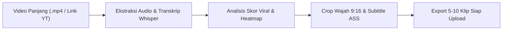
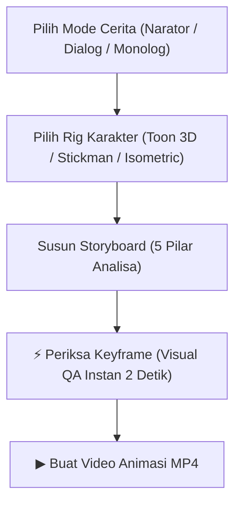
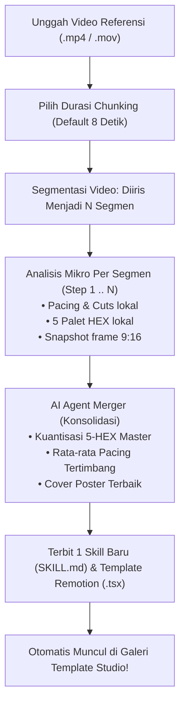

# Panduan Lengkap Penggunaan Cheat Clip & Motion

> **Buku Manual Resmi & Panduan Langkah demi Langkah (End-to-End)**  
> Meliputi: Fitur Klip, Motion Standar (Ide, Manual, Animasi Bergerak), Motion Pro (Long-Form 4m+), Ekstrak Gaya Video (Chunking 8s & AI Merger), Ekosistem Gemini Canvas (Naskah & SEO Viral), serta Konfigurasi Pengaturan AI.
> 
> *Pengembang:* **Bayunity** untuk kebutuhan internal **BRKH Studio**  
> *Basis Arsitektur:* **Maliki Saputra (@malikisaputra)** — [malikisaputra.biz.id](https://malikisaputra.biz.id)

---

## Daftar Isi
1. [Fitur Klip: Panduan & Pengunduhan via GitHub](#1-fitur-klip-panduan--pengunduhan-via-github)
2. [Fitur Motion: Dari Topik, Naskah Manual, hingga Animasi Bergerak](#2-fitur-motion-tiga-mode-produksi-lengkap)
   - [2.1 Mode Dari Topik (AI Otomatis)](#21-mode-dari-topik-ai-otomatis)
   - [2.2 Mode Naskah Manual (Teks Bebas & JSON)](#22-mode-naskah-manual-teks-bebas--json)
   - [2.3 Mode Studio Animasi Karakter Bergerak (Multi-Scene & Multi-Tokoh)](#23-mode-studio-animasi-karakter-bergerak-multi-scene--multi-tokoh)
3. [Fitur Motion Pro: Produksi Video Panjang (4–15+ Menit)](#3-fitur-motion-pro-produksi-video-panjang-415-menit)
4. [Fitur Ekstrak Gaya Video: Chunking 8 Detik & AI Merger](#4-fitur-ekstrak-gaya-video-chunking-8-detik--ai-merger)
5. [Tutorial Ekosistem Gemini Canvas: Naskah, Visual Bible, hingga SEO](#5-tutorial-ekosistem-gemini-canvas-naskah-visual-bible--seo-viral)
   - [5.1 Generator Naskah Video Pendek, TTS & Visual Bible](#51-generator-naskah-video-pendek-tts--visual-bible)
   - [5.2 Alur 1-Klik Impor ke Storyboard Motion](#52-alur-1-klik-impor-ke-storyboard-motion)
   - [5.3 Generated SEO for YouTube & Social Media Viral](#53-generated-seo-for-youtube--social-media-viral)
6. [Panduan Lengkap Pengaturan AI & Kebutuhan Sistem](#6-panduan-lengkap-pengaturan-ai--kebutuhan-sistem)
   - [6.1 Google Gemini API & Rolling Multi-Keys](#61-google-gemini-api--rolling-multi-keys)
   - [6.2 OpenAI & Server Lokal Ollama](#62-openai--server-lokal-ollama)
   - [6.3 Akun Langganan CLI (Antigravity CLI / Claude Code / Codex)](#63-akun-langganan-cli-antigravity-cli--claude-code--codex)
   - [6.4 Pengaturan Suara & Voice-Over (Offline, VoxCPM, ElevenLabs)](#64-pengaturan-suara--voice-over-offline-voxcpm-elevenlabs)
7. [Pusat Bantuan & Kontak Dukungan Resmi](#7-pusat-bantuan--kontak-dukungan-resmi)

---

## 1. Fitur Klip: Panduan & Pengunduhan via GitHub

Fitur **Klip** dirancang khusus untuk memotong video rekaman panjang (seperti podcast, kajian, seminar, atau video YouTube) menjadi klip pendek 9:16 yang memiliki potensi viral tinggi, lengkap dengan transkripsi subtitle kata per kata (*karaoke word-level*), framing crop wajah otomatis (*face tracking*), dan deteksi *YouTube Heatmap*.



### Arahan Mengunduh dan Memasang Modul Klip:
Saat ini, mesin Klip dioptimalkan berjalan terpisah dari Studio agar tidak membebani memori laptop ketika sedang memproses model AI Whisper dan deteksi visual.

1. **Unduh Repositori Resmi dari GitHub:**
   Buka terminal (Command Prompt / PowerShell / Terminal Mac) dan clone repositori:
   ```bash
   git clone https://github.com/Bayunity-Brkhstd/motion.git
   cd motion
   ```
   *Atau unduh berkas ZIP langsung dari laman repositori GitHub: [https://github.com/Bayunity-Brkhstd/motion](https://github.com/Bayunity-Brkhstd/motion).*

2. **Masuk ke Sub-Direktori Klip:**
   ```bash
   cd klip
   ```

3. **Jalankan Instalasi Dependensi Python:**
   Pastikan Anda telah memasang Python 3.10–3.12 dan pengelola paket modern `uv`:
   ```bash
   # Pasang uv jika belum ada
   pip install uv

   # Jalankan skrip setup Klip
   uv run klip.py --bantuan
   ```

4. **Menjalankan Pemotongan Klip:**
   * **Dari Berkas Video Lokal:**
     ```bash
     uv run klip.py --sumber "D:/video/podcast_panjang.mp4" --durasi-klip 60 --keluar "D:/hasil_klip/"
     ```
   * **Dari URL YouTube Langsung:**
     ```bash
     uv run klip.py --sumber "https://www.youtube.com/watch?v=XXXXX" --klip-maks 5
     ```
5. Hasil klip yang telah jadi akan tersimpan rapi di folder keluaran bersama file `.ass` subtitle kinetik dan siap dipublikasikan ke Shorts, Reels, atau TikTok.

---

## 2. Fitur Motion: Tiga Mode Produksi Lengkap

Tab **Motion** adalah mesin pembuat video animasi vertikal (1080×1920) 30 FPS berbasis **React Remotion**. Di tab ini terdapat 3 mode pembuatan video yang fleksibel:

---

### 2.1 Mode "Dari Topik (AI Otomatis)"
Mode tercepat untuk membuat video edukasi dari satu baris ide tanpa perlu mengetik naskah sendiri.

```
+-------------------------------------------------------------+
| TOPIC INPUT:                                                |
| "3 Alasan Kenapa Bangun Pagi Mengubah Finansialmu"         |
|                                                             |
|                       v [Klik Buat Video]                   |
|                                                             |
| HASIL AI:                                                   |
| - Scene 1 (Hook): "Kamu masih sering bangun jam 8 pagi?"    |
| - Scene 2 (Poin 1): "Studi membuktikan otak paling fokus..." |
| - Scene 3 (Poin 2): "Waktu hening tanpa distraksi chat..."  |
| - Scene 4 (CTA): "Mulai pasang alarm besok jam 5 pagi!"     |
+-------------------------------------------------------------+
```

#### Langkah-langkah:
1. Klik menu **Motion** di sidebar kiri.
2. Di sub-nav atas, pastikan tab aktif adalah **Dari topik (AI)**.
3. Ketikkan topik yang ingin dibuat pada kotak input (contoh: *"Mengapa orang sukses lebih suka pakai baju yang sama setiap hari"*).
4. Di kolom kanan, pilih salah satu dari **25+ Template Visual** (misalnya *Flat Vector*, *Komik*, *Sketsa Emas*, atau template kustom hasil ekstraksi Anda).
5. Tentukan sumber audio:
   * **Suara Bawaan / AI:** Memakai text-to-speech otomatis.
   * **Upload Audio Sendiri:** Menggunakan voice over rekaman Anda sendiri (`.mp3` atau `.wav`).
6. Klik tombol **▶ Buat video**. AI akan menulis naskah, mencocokkan ritme visual dengan template, dan merender video `.mp4`.

---

### 2.2 Mode "Naskah Manual (Teks Bebas & JSON)"
Bagi Anda yang sudah memiliki naskah sendiri dan ingin kendali penuh atas kalimat setiap adegan.

#### Langkah-langkah:
1. Di tab Motion, pilih sub-nav **Manual**.
2. Anda dapat memasukkan naskah dengan dua format:
   * **Format Teks Bebas:**  
     Pisahkan setiap adegan dengan baris kosong atau bullet point. AI akan memecahnya menjadi potongan adegan 3–5 detik.
   * **Format JSON Presisi:**  
     Gunakan struktur objek adegan:
     ```json
     [
       {
         "judul": "Kenapa Gaji Cepat Habis?",
         "durasi_detik": 4.0,
         "narasi": "Pernahkah kamu merasa baru gajian tiga hari tapi saldo sudah menipis?",
         "palet": ["#0f172a", "#38bdf8", "#facc15", "#f43f5e", "#ffffff"]
       },
       {
         "judul": "Fenomena Lifestyle Inflation",
         "durasi_detik": 4.5,
         "narasi": "Ini yang disebut inflasi gaya hidup, pengeluaran naik seiring gaji naik.",
         "palet": ["#0f172a", "#38bdf8", "#facc15", "#f43f5e", "#ffffff"]
       }
     ]
     ```
3. Pilih template visual di kolom kanan, lalu klik **▶ Buat video**.

---

### 2.3 Mode "Studio Animasi Karakter Bergerak" (Multi-Scene & Multi-Tokoh)
Ini adalah mode paling mutakhir untuk memproduksi video kartun/animasi bergerak edukasi dengan **karakter rig dinamis**, konsistensi tokoh dari awal hingga akhir, dan rekonstruksi visual narasi.



#### Step 1: Memilih Mode Cerita
Terdapat 4 mode penyampaian yang mempengaruhi tampilan layar:
* **🎙️ Narator (Visual Re-enactment) — *Paling Direkomendasikan*:**  
  Audio dibawakan oleh 1 narator/voice-over. Visual karakter dan latar merekonstruksi kejadian yang sedang diceritakan. **Balon obrolan dimatikan (OFF)** agar layar bersih, luas, dan sinematik. Subtitle narasi mengalir elegan di bawah.
* **💬 Dialog Antar Tokoh:**  
  Sketsa percakapan timbal balik 2 tokoh. **Balon kata komik otomatis menyala (ON)** dan berpindah dinamis di atas kepala tokoh yang sedang bicara.
* **👤 Monolog / POV Curhat:**  
  1 Tokoh menghadap ke arah kamera/audiens membawakan narasi secara ekspresif.
* **📊 Infografis Kinetik:**  
  Karakter bertindak sebagai presenter/pemandu data dengan sorotan teks dan grafik kinetik.

#### Step 2: Memilih Rig Karakter & Gaya Visual
Pilih dari 3 rig karakter native memory (< 600 MB RAM):
1. **Toon 3D (Cel-Shaded):** Karakter bergaya kartun modern 3D cel-shaded dengan garis kontur tegas, mata oval ekspresif, dan bayangan solid.
2. **Stickman (Kinetic 2D):** Karakter stickman kinetik dengan fisika melangkah `sin(t)`, sendi siku dinamis, dan properti tangan.
3. **Isometric (3D Balok & Tech Grid):** Gaya edukasi visual isometrik 30° dengan balok teknologi dan maskot drone.

#### Step 3: Mengisi Storyboard (Framework 5 Pilar)
AI Director menyusun cerita berdasarkan 5 pilar konsistensi:
1. **Latar Tempat:** Menentukan environment spesifik (misal: `Warung Desa Siforejo`, `Pelataran Masjid`, `Ruang Kantor`).
2. **Aset & Properti:** Objek interaksi pendukung (misal: *Cangkir Kopi Tubruk*, *Map Berkas*, *Sepeda Motor*).
3. **Jumlah Tokoh:** Fleksibel per adegan (0 = B-roll suasana, 1 = Monolog/panik sendiri, 2 = Dua tokoh berinteraksi).
4. **Konsistensi Visual:** Mengunci pakaian, warna kulit, dan ciri fisik (misal: *Pak Budi selalu memakai Kemeja Batik Cokelat `#78350F` di setiap adegan*).
5. **Konsep Adegan:** Peragaan gerak tubuh dan mimik karakter yang menghidupkan kalimat narasi.

#### Step 4: Visual QA Mandiri Sebelum Render
Sebelum merender video utuh, klik tombol **⚡ Periksa Keyframe**. Mesin Remotion akan mengambil snapshot frame pertama dalam waktu 2 detik. Jika pose karakter, warna latar, dan proporsi sudah pas di mata Anda, baru klik tombol **▶ Buat video**.

---

## 3. Fitur Motion Pro: Produksi Video Panjang (4–15+ Menit)

**Motion Pro** adalah workspace khusus yang dirancang untuk memproduksi video horizontal (16:9) atau vertikal (9:16) berdurasi panjang ($\ge 4$ menit s.d. 15+ menit) untuk konten explainer YouTube, dokumenter edukasi, atau video esai.

### Mengapa Motion Pro Membutuhkan AI Agent CLI?
Menghasilkan video 10 menit memerlukan pemrosesan lebih dari 60–100 adegan terstruktur. Jika menggunakan API token per-request biasa, biaya tagihan akan membengkak dan token cepat habis.  
Oleh karena itu, Motion Pro memanfaatkan **akun langganan resmi** pengguna (seperti Claude Pro via Claude Code CLI, Gemini Advanced via Antigravity CLI, atau ChatGPT Plus via Codex CLI) yang memiliki batas kuota harian sangat besar.

### Langkah demi Langkah Menggunakan Motion Pro:
1. **Persiapkan 3 Berkas Aset Utama:**
   * **Audio Voice-Over (`.wav`):** File suara narasi utuh yang sudah direkam atau diekspor dari ElevenLabs.
   * **Naskah Markdown (`.md`):** Naskah cerita terstruktur yang sudah dibagi per babak dan adegan.
   * **Gambar Referensi (Opsional):** 1–3 gambar panduan estetika yang diinginkan.
2. **Buka Tab Motion Pro:**
   Klik **Motion Pro** pada sidebar kiri Studio. *(Jika terkunci, hubungi WhatsApp Admin resmi di `+62 838-6230-0495` untuk mendapatkan kode otorisasi internal).*
3. **Pilih Modul Skill yang Aktif:**
   Centang modul skill yang ingin digunakan (misal: `toon-3d-explainer`, `isometric-video`, `sound-effects`).
4. **Panggil Sutradara AI:**
   Klik **Salin Prompt Sutradara AI**, lalu buka terminal Anda dan tempelkan prompt tersebut ke Claude Code atau Antigravity CLI. AI Agent akan secara otonom membedah naskah, memetakan timing audio per kata, menulis kode komposisi Remotion, dan merender video final ke folder `motion/hasil/`.

---

## 4. Fitur Ekstrak Gaya Video: Chunking 8 Detik & AI Merger

Fitur **Ekstrak Gaya Video** adalah mesin pembalik (*reverse engineering*) visual. Anda dapat memasukkan sembarang video referensi dari TikTok, Reels, atau YouTube Shorts, dan mesin akan mengekstrak DNA visualnya menjadi **Skill AI baru** dan **Template Remotion baru**.



### Panduan Langkah demi Langkah:
1. Buka menu **Ekstrak Gaya** di sidebar kiri.
2. **Tarik atau Pilih File Video Referensi:** Masukkan video favorit Anda (disarankan durasi 15 detik s.d. 2 menit).
3. **Tentukan Kategori Ekstraksi:**
   * **🎬 Animasi Bergerak:** Mengekstrak karakter rig, outline cel-shaded, pacing 2–4 detik untuk Studio Animasi.
   * **🖼️ Grafis Statis:** Mengekstrak 5 warna HEX, tipografi, dan komposisi vektor untuk Motion Standar.
4. **Tentukan Nama / Slug Gaya:** Ketik nama unik (contoh: `anime-cyberpunk` atau `stickman-investasi`).
5. **Konfigurasi Chunking Waktu:**
   * **8 Detik (Rekomendasi Standar):** Rasio terbaik antara presisi transisi dan kecepatan proses.
   * **6 Detik (Super Mikro):** Sangat detail, cocok untuk video bertempo cepat (*fast-paced editing*).
   * **12 Detik (Santai):** Cocok untuk video podcast atau dokumenter tenang.
6. **Aktifkan Opsi Auto-Hapus Video Mentah:** Centang agar file video sumber langsung dibersihkan pasca-analisis untuk menghemat memori penyimpanan.
7. Klik tombol **✨ Mulai Ekstraksi Gaya & Daftarkan Global**.
8. **Hasil Akhir:**
   * Mesin menampilkan galeri horizontal snapshot seluruh segmen yang dianalisis.
   * File Skill otomatis terbit di `motion/skills/<slug>/SKILL.md` lengkap dengan tabel rekap analisis per segmen di Bagian 6.
   * Template otomatis muncul di posisi paling atas galeri template tab Motion dan siap langsung dipakai!

---

## 5. Tutorial Ekosistem Gemini Canvas: Naskah, Visual Bible & SEO Viral

Untuk mempermudah kreator dari tahap ide nol hingga publikasi, ekosistem Cheat Clip & Motion terhubung dengan **Google Gemini Canvas resmi**:

---

### 5.1 Generator Naskah Video Pendek, TTS & Visual Bible
🔗 **Tautan Resmi:** [https://share.gemini.google/NFulYmtV6Anl](https://share.gemini.google/NFulYmtV6Anl)

Aplikasi Canvas ini adalah asisten sutradara interaktif yang menulis naskah adegan demi adegan, memisahkan teks audio bersih, dan menyusun kamus konsistensi tokoh.

```
+---------------------------------------------------------------------------------+
|                        GEMINI CANVAS INTERFACE                                  |
|                                                                                 |
| 1. Sumber Ide: [ Ide Otomatis / Topik ] atau [ Olah Draf Sendiri ]              |
| 2. Gaya Penyampaian: [ 1 Narator Utama ] vs [ Dialog Antar Tokoh ]              |
| 3. Niche: [ Tech & AI ] [ Sains ] [ Hukum & Kasus Viral ] [ Psikologi ] ...    |
| 4. Kamus Tokoh & Latar (Opsional):                                              |
|    - Tokoh: Pak Budi (Kemeja batik cokelat, kacamata kotak)                     |
|    - Latar: Halaman Sekolah -> Ruang Kelas -> Kantor Kepala Sekolah             |
|                                                                                 |
|               [ 🚀 Generate Naskah, TTS & Visual Bible Sekarang ]               |
+---------------------------------------------------------------------------------+
```

#### Memahami 4 Format Keluaran Canvas:
* **Format 1: Naskah Tag Latar (`studio.py` / Editor):**  
  Naskah terstruktur rapi dengan penanda adegan `[ADEGAN 1 | LATAR: Halaman Sekolah]`. Sangat cocok dibaca manusia dan editor visual.
* **Format 2: Naskah Bersih Siap Baca (TTS Engine):**  
  Naskah yang sudah dibersihkan 100% dari tag kurung siku, timestamp, maupun simbol emoji. Format ini **langsung siap di-copy-paste** ke ElevenLabs atau Google AI Studio TTS agar suara mesin tidak salah membaca tag.
* **Format 3: Visual Bible & Kamus Konsistensi Tokoh:**  
  Rincian warna cat tembok latar, genteng, dan pakaian tokoh yang dikunci agar tidak berubah-ubah antar-adegan.
* **Format 4: Manifest Storyboard JSON (Deterministic Pipeline):**  
  Data JSON murni (`adegan_storyboard`) yang berisi parameter durasi, aksi tokoh, dan latar yang siap dikonsumsi langsung oleh mesin render.

---

### 5.2 Alur 1-Klik Impor ke Storyboard Motion
Anda tidak perlu lagi menyalin satu per satu baris naskah:
1. Di Canvas Gemini, klik tombol **Salin** pada kotak **Format 1** atau **Format 4 (JSON)**.
2. Buka aplikasi Studio di browser (`http://127.0.0.1:8787`), masuk ke tab **Motion** $\rightarrow$ **Animasi Karakter**.
3. Pastikan tab aktif di Storyboard adalah **📥 Impor dari Canvas Gemini (1-Klik)**.
4. Klik kanan dan **Paste** naskah Anda di textarea yang disediakan.
5. Klik tombol **⚡ Terapkan Naskah**.
6. Seketika itu juga seluruh daftar adegan, latar tempat, dan dialog langsung terisi otomatis di Storyboard!

---

### 5.3 Generated SEO for YouTube & Social Media Viral
🔗 **Tautan Resmi:** [https://share.gemini.google/BVWFVYHdez50](https://share.gemini.google/BVWFVYHdez50)

Setelah video Anda selesai dirender, buka tool Canvas SEO untuk memaksimalkan jangkauan penonton di YouTube Shorts, TikTok, dan Reels:
1. Masukkan topik atau ringkasan cerita video Anda.
2. Canvas SEO akan menghasilkan:
   * **5 Variasi Judul Click-Worthy (CTR Tinggi):** Berdasarkan formula hook penasaran dan emosional.
   * **Deskripsi Video Algoritmik:** Paragraf pembuka ramah SEO lengkap dengan kata kunci relevan.
   * **Daftar 30+ Hashtag & Tag Pencarian:** Campuran tag spesifik dan tag viral (*trending tags*).
   * **Prompt Desain Thumbnail:** Prompt siap pakai untuk Midjourney atau Flux guna menghasilkan thumbnail magnetik.

---

## 6. Panduan Lengkap Pengaturan AI & Kebutuhan Sistem

Buka menu **Pengaturan AI** (ikon roda gigi di sidebar kiri) untuk mengelola kunci API dan preferensi model.

---

### 6.1 Google Gemini API & Rolling Multi-Keys
Google Gemini API adalah mesin yang paling direkomendasikan karena cepat, cerdas, dan menyediakan kuota gratis yang memadai.

#### Cara Mendapatkan API Key Gratis:
1. Kunjungi [Google AI Studio (aistudio.google.com)](https://aistudio.google.com).
2. Masuk dengan akun Google Anda.
3. Klik tombol **Get API key** $\rightarrow$ **Create API key in new project**.
4. Salin kode kunci yang diawali dengan `AIzaSy...`.

#### Fitur Rolling API Keys (Anti-Batas Kuota / Rate Limit 15 RPM):
Tingkat gratis (*free tier*) Gemini membatasi 15 request per menit (RPM). Jika Anda merender banyak adegan sekaligus, kuota 1 kunci bisa habis sementara (*RateLimit 429*).  
Studio Cheat Clip & Motion memiliki fitur **Multi-Key Rolling**:
* Buat 2–3 API key dari proyek Google yang berbeda.
* Masukkan semua kunci ke kolom **Google Gemini API Key** dengan dipisahkan tanda koma:
  ```text
  AIzaSyAkun1_XXXXX, AIzaSyAkun2_YYYYY, AIzaSyAkun3_ZZZZZ
  ```
* Studio akan secara otomatis merotasi kunci tersebut di setiap adegan, sehingga render tidak pernah terhenti karena kuota!

---

### 6.2 OpenAI & Server Lokal Ollama
Bagi Anda yang menyukai model OpenAI atau ingin menjalankan model 100% offline tanpa internet:
* **OpenAI API:** Masukkan API Key OpenAI Anda yang diawali `sk-...`.
* **Ollama (100% Offline Lokal):**
  1. Pasang Ollama di PC Anda dari [ollama.com](https://ollama.com).
  2. Jalankan model melalui terminal: `ollama run llama3` atau `ollama run mistral`.
  3. Di Pengaturan AI Studio, arahkan base URL ke `http://127.0.0.1:11434/v1`.

---

### 6.3 Akun Langganan CLI (Antigravity CLI / Claude Code / Codex)
Untuk memproduksi video panjang di **Motion Pro**:
1. Pastikan Anda telah memasang CLI resmi di terminal komputer Anda:
   * **Antigravity CLI:** Menggunakan Google Antigravity 2.0 SDK.
   * **Claude Code:** Pasang via `npm install -g @anthropic-ai/claude-code`, lalu jalankan `claude login`.
   * **Codex CLI:** Masuk via akun OpenAI CLI resmi.
2. Studio mendeteksi file otorisasi aktif secara otomatis di sistem Anda (`hub_*.json`).
3. Widget **AI: Antigravity CLI** di pojok kiri bawah Studio akan menyala hijau dan menampilkan status kuota model Anda secara realtime.

---

### 6.4 Pengaturan Suara & Voice-Over
Tersedia 3 opsi sumber audio untuk narasi:
1. **Suara Bawaan Sistem (Windows SAPI / Edge TTS):**  
   100% gratis, tanpa kuota, dan bekerja instan tanpa download file besar. Pilihan suara: *Damayanti* (wanita ramah) atau *Ardi* (pria berwibawa).
2. **Suara AI Lokal VoxCPM (~5 GB):**  
   Menghasilkan intonasi bahasa Indonesia yang sangat manusiawi serta mendukung *voice cloning* (kloning suara sendiri dari sampel audio 15 detik). Klik tombol **Pasang suara AI (±5 GB)** di Pengaturan untuk mengunduh model.
3. **Menggunakan ElevenLabs Eksternal:**  
   Salin naskah dari **Format 2 (Canvas Gemini)**, tempelkan ke akun [ElevenLabs](https://elevenlabs.io), unduh file audionya (`.mp3`), lalu di tab Motion pilih opsi **Upload Audio Sendiri (.mp3 / .wav)**.

---

## 7. Pusat Bantuan & Kontak Dukungan Resmi

Jika Anda mengalami kendala teknis saat setup, membutuhkan konsultasi kustomisasi template Remotion, atau ingin mengajukan kode akses untuk Motion Pro, Anda dapat menghubungi developer langsung melalui saluran resmi berikut:

* **WhatsApp Resmi:** [**+62 838-6230-0495**](https://wa.me/6283862300495?text=Halo%20Admin%20Cheat%20Clip%20%26%20Motion,%20saya%20butuh%20bantuan%20seputar%20penggunaan%20studio)
* **Website Resmi:** [malikisaputra.biz.id](https://malikisaputra.biz.id)
* **Repositori GitHub:** [github.com/Bayunity-Brkhstd/motion](https://github.com/Bayunity-Brkhstd/motion)

---
*Cheat Clip & Motion — Mengubah ide dan video referensi menjadi konten animasi berkualitas tinggi dalam hitungan menit.*
