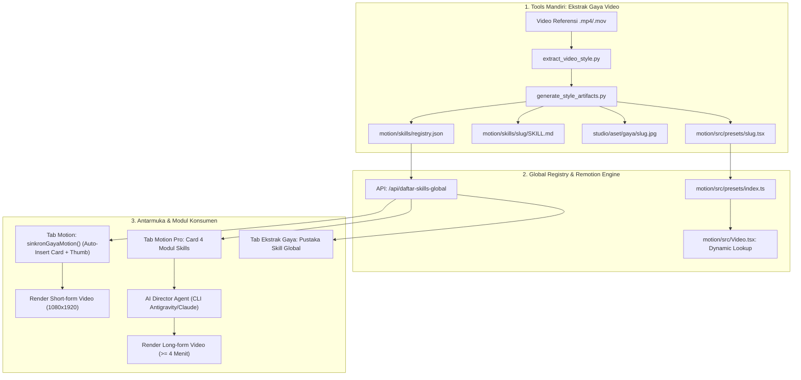
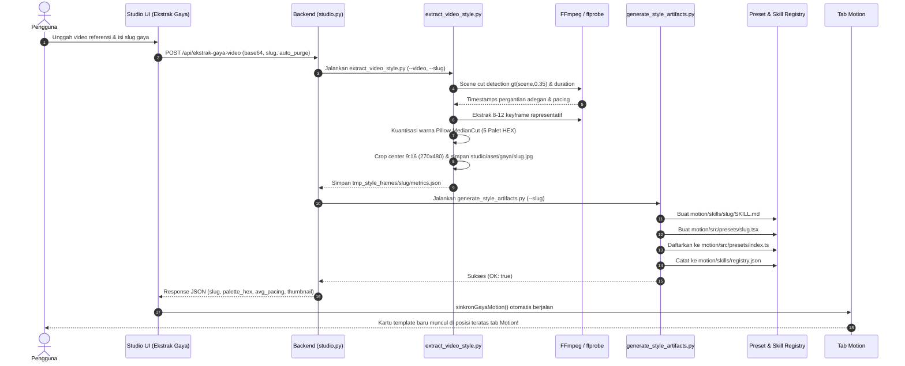
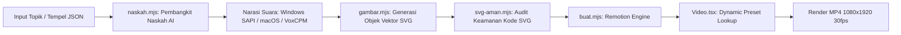
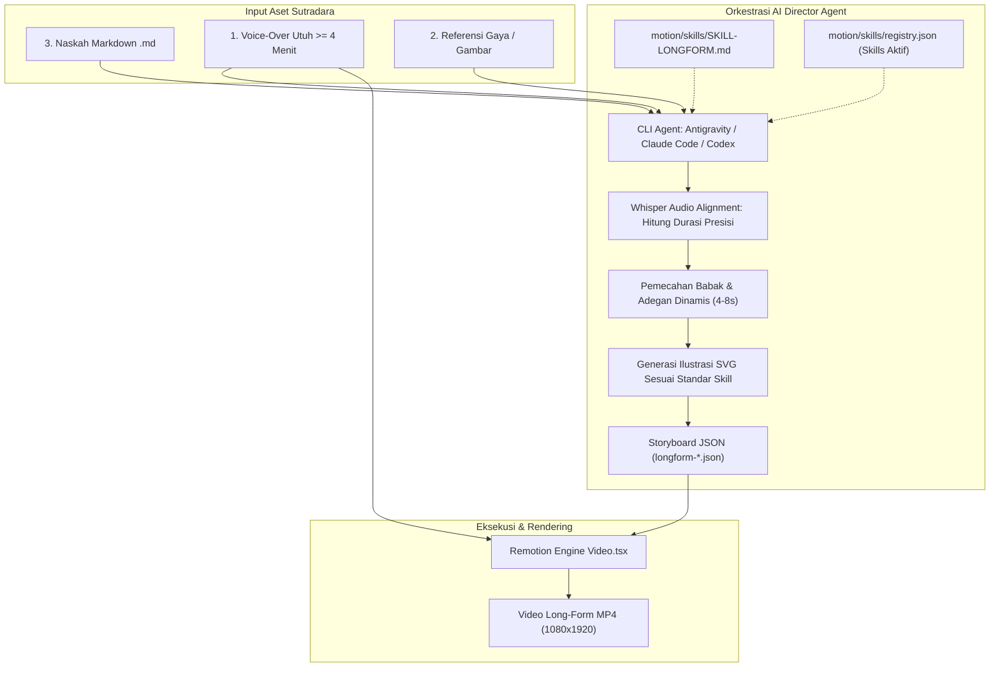

# Alur Kerja Pipeline & Arsitektur Sistem (Cheat Clip and Motion)

> Dokumentasi teknis komprehensif yang memetakan keterhubungan ekosistem **Motion Standar**, **Motion Pro**, dan **Tools Ekstrak Gaya Video** dari hulu ke hilir (End-to-End Pipeline A sampai Z).

---

## 1. Arsitektur Umum & Ekosistem Sistem

Aplikasi ini menggabungkan mesin rendering video deterministik berbasis **React Remotion** dengan kapabilitas pemrosesan AI (CLI Agent dan script otomatis Python) yang berjalan **100% lokal** di komputer pengguna.

Ekosistem terbagi menjadi tiga pilar fungsional yang saling terhubung:

---

## 2. Deep-Dive Pipeline: Ekstraksi Gaya Video (A sampai Z)

Pipeline ini memungkinkan video referensi dari platform apa pun (seperti video TikTok, Reels, atau YouTube Shorts) dibedah DNA visual dan ritme editing-nya, lalu otomatis diterjemahkan menjadi **Remotion Template baru** dan **AI Skill baru**.

### Tahapan Rinci:

#### 1. Input & Preparasi
- Pengguna memilih file video (`.mp4`, `.mov`, `.webm`) melalui drag-and-drop di tab **Ekstrak Gaya**.
- Sistem menghasilkan saran slug otomatis dari nama file (misal: `toon-3d-celshaded`).
- Pengguna dapat mencentang **Auto-Hapus video mentah** untuk menghemat ruang disk.
- File dikirim ke backend `/api/ekstrak-gaya-video`.

#### 2. Analisis Visual & Pacing (`scripts/extract_video_style.py`)
- **Pendeteksian Pacing:** `ffprobe` membaca metadata durasi, lalu `ffmpeg` mengeksekusi filter `select='gt(scene,0.35)'` untuk mendeteksi setiap cut pergantian scene. Rata-rata durasi per adegan dihitung (`avg_pacing_sec = total_durasi / scene_count`).
- **Kuantisasi Warna 5 HEX:** Keyframe representatif diambil dan digabungkan menjadi kanvas analisis warna menggunakan modul MedianCut Pillow untuk mengekstrak 5 warna HEX yang paling kontras dan berkarakter (Background utama, teks kontras, warna kontainer, aksen primer, dan aksen sekunder).
- **Auto-Capture Thumbnail 9:16:** Mengambil 1 screenshot terbaik dari adegan aktif video, di-center crop ke rasio 9:16 (270 × 480 px), dan disimpan langsung ke `studio/aset/gaya/<slug>.jpg`.
- **Output:** Menghasilkan file manifest DNA visual di `tmp_style_frames/<slug>/metrics.json`.
- **Pembersihan Otomatis:** Jika flag `--purge` aktif, video mentah langsung dihapus dari disk.

#### 3. Pembuatan Artefak Global (`scripts/generate_style_artifacts.py`)
- **Global AI Skill (`motion/skills/<slug>/SKILL.md`):**
  - Dilengkapi frontmatter YAML valid (`name`, `description`).
  - Berisi petunjuk pacing ketat untuk AI Director.
  - Memuat 5 palet warna HEX wajib yang harus diisi di `naskah.json`.
  - Memuat standar baku ilustrasi SVG aman (tanpa tag `<script>` atau event handler `on*` agar 100% lolos verifikasi `svg-aman.mjs`).
  - Aturan teks layar (maksimal kata judul) dan fisika pegas Remotion.
- **Preset Komposisi Remotion (`motion/src/presets/<slug>.tsx`):**
  - Mengonstruksi komponen latar dinamis React berbasis kode SVG dengan palet warna ekstraksi.
  - Mengekspor objek bertipe `StylePreset` yang memuat parameter font, bobot, mode animasi judul, mode subtitle, serta konfigurasi pegas (`spring({ stiffness, damping })`).
- **Pembaruan Dynamic Registry (`motion/src/presets/index.ts`):**
  - Otomatis menyisipkan baris `import { preset_<slug> } from './<slug>';` dan meregistrasikannya ke dalam objek `STYLE_PRESETS`.
- **Pembaruan Global Skill Manifest (`motion/skills/registry.json`):**
  - Menyimpan entri `{ slug, name, description, palette_hex, avg_pacing_sec, thumbnail, created_at, inti: false }`.

#### 4. Distribusi & Tampilan di Antarmuka Studio
- **Sinkronisasi Tab Motion (`sinkronGayaMotion`):**
  - Frontend memanggil `/api/daftar-skills-global`.
  - Kartu template baru disisipkan secara dinamis di **urutan teratas** grid template tab Motion (`#pilGaya`).
  - Kartu menampilkan gambar screenshot `studio/aset/gaya/<slug>.jpg`, label badge `Video Ref`, dan counter template bertambah (mis. `Gaya · 25 template`).
- **Sinkronisasi Tab Motion Pro:**
  - Card 4 ("Skills & Plugin Eksternal") langsung menampilkan badge skill baru tersebut sehingga siap dipanggil oleh AI Director Agent.
- **Pustaka di Tab Ekstrak Gaya:**
  - Kolom kanan langsung menampilkan kartu pustaka global lengkap dengan thumbnail, palet warna interaktif, dan tombol hapus jika tidak lagi digunakan.

---

## 3. Deep-Dive Alur: Motion Standar (Short-Form Video)

Modul **Motion Standar** dirancang untuk memproduksi video pendek animasi berorientasi vertikal 9:16 (1080 × 1920) secara cepat:

1. **Pemilihan Gaya:** Pengguna memilih salah satu dari 24 template bawaan atau template kustom hasil ekstraksi video di grid `#pilGaya`.
2. **Pembangkitan Naskah (`motion/naskah.mjs`):** AI (Gemini / Claude / Ollama) menyusun naskah per adegan berstruktur JSON (`judul`, `teks`, `kunci`, `ikon`, `durasi`).
3. **Penyintesis Suara:** Suara narator dihasilkan per adegan (`public/suara/*.wav`) dan panjang suara diukur otomatis sebagai durasi adegan.
4. **Ilustrasi SVG Otomatis (`motion/gambar.mjs`):** AI menggambar objek SVG untuk memperkaya visual adegan, lalu diaudit oleh `motion/svg-aman.mjs` agar bebas dari script berbahaya.
5. **Rendering Dinamis (`motion/src/Video.tsx`):**
   - Remotion membaca properti `gaya`.
   - Fungsi `temaDari(p)` mencari preset di `STYLE_PRESETS[p.gaya] ?? TEMA[p.gaya] ?? STYLE_PRESETS['garis']`.
   - Video dirender menjadi file MP4 beresolusi 1080 × 1920 pada 30 fps di folder `hasil/`.

---

## 4. Deep-Dive Alur: Motion Pro (Long-Form Video $\ge 4$ Menit)

Modul **Motion Pro** adalah workspace khusus sutradara video panjang berdurasi 4 hingga 15+ menit berbasis integrasi CLI AI Agent resmi:

1. **Aset Utama:**
   - **Voice-Over:** Audio narasi utuh tanpa jeda musik yang sudah direkam/disintesis.
   - **Naskah Markdown:** Naskah terstruktur per babak dan adegan.
   - **Gambar Referensi:** Panduan visual agar karakter dan objek konsisten.
2. **Koneksi CLI AI Agent:**
   - Tidak menggunakan API Key langsung, melainkan mengeksekusi CLI resmi langganan pengguna (`antigravity`, `claude`, `codex`, atau `opencode`).
   - Agent membaca aturan sutradara dari `motion/skills/SKILL-LONGFORM.md` dan modul-modul skill aktif yang terdaftar di `motion/skills/registry.json`.
3. **Penyusunan Storyboard & Keamanan:**
   - Agent melakukan chunking adegan agar setiap potongan adegan berdurasi 4–8 detik dengan pergantian visual dinamis (mencegah penonton bosan).
   - Seluruh grafis vektor SVG disaring dengan `motion/svg-aman.mjs`.
4. **Rendering Panjang:**
   - Storyboard disimpan ke `motion/naskah/longform-<timestamp>.json`.
   - Audio narasi utuh dipasang langsung via properti `audioNarasi`, sementara visual adegan bergerak secara sinkron di timeline Remotion.

---

## 5. Ringkasan File & Direktori Inti

| Direktori / File | Peran Utama |
|---|---|
| `studio/studio.py` | Server backend lokal, router API (`/api/ekstrak-gaya-video`, `/api/daftar-skills-global`, dll.), serta runner proses CLI. |
| `studio/index.html` | Antarmuka pengguna (SPA), mencakup Beranda, Klip, Motion, Motion Pro, dan Tools Ekstrak Gaya. |
| `scripts/extract_video_style.py` | Engine ekstraksi visual video (scene detection, 5 palet HEX, capture thumbnail 9:16). |
| `scripts/generate_style_artifacts.py` | Generator artefak otomatis (`SKILL.md`, `preset.tsx`, registrasi `index.ts`, dan `registry.json`). |
| `studio/aset/gaya/<slug>.jpg` | Folder thumbnail visual 9:16 untuk kartu template di tab Motion dan Ekstrak Gaya. |
| `motion/skills/` | Modul keahlian AI (skill bawaan + skill baru hasil ekstraksi video referensi). |
| `motion/skills/registry.json` | Manifest global seluruh skill yang terdaftar di sistem. |
| `motion/src/presets/` | Folder komponen preset komposisi Remotion kustom. |
| `motion/src/presets/index.ts` | Indeks sentral yang mengekspor seluruh preset ke `STYLE_PRESETS`. |
| `motion/src/Video.tsx` | Komposisi inti Remotion dengan *dynamic lookup* gaya. |
| `motion/svg-aman.mjs` | Filter validator keamanan SVG (mencegah `<script>` dan atribut event). |
