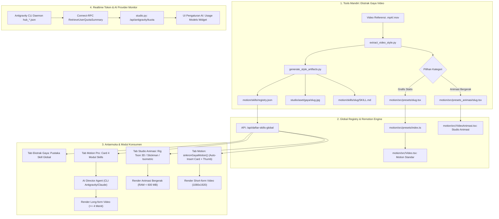
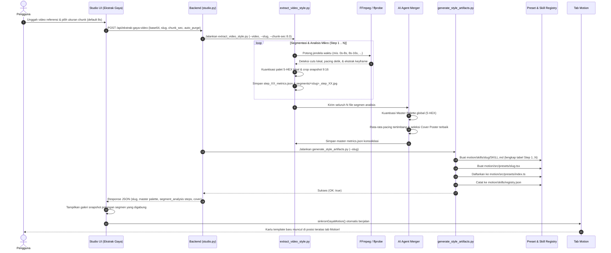
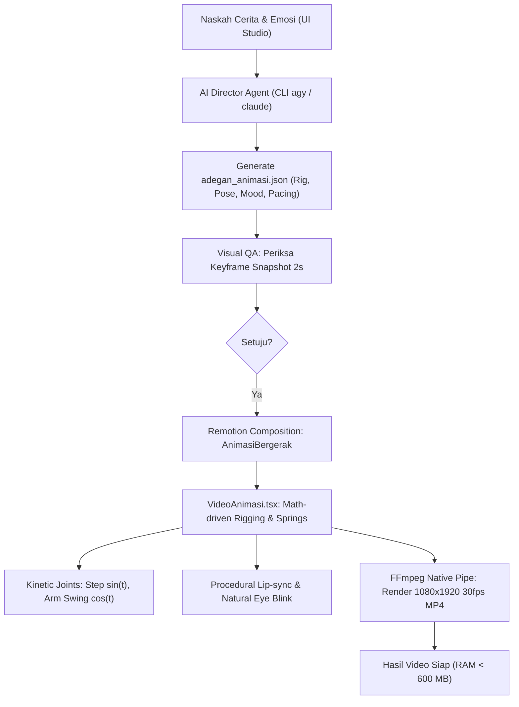
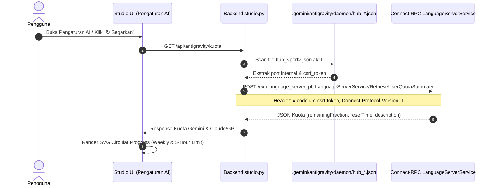
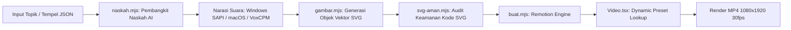
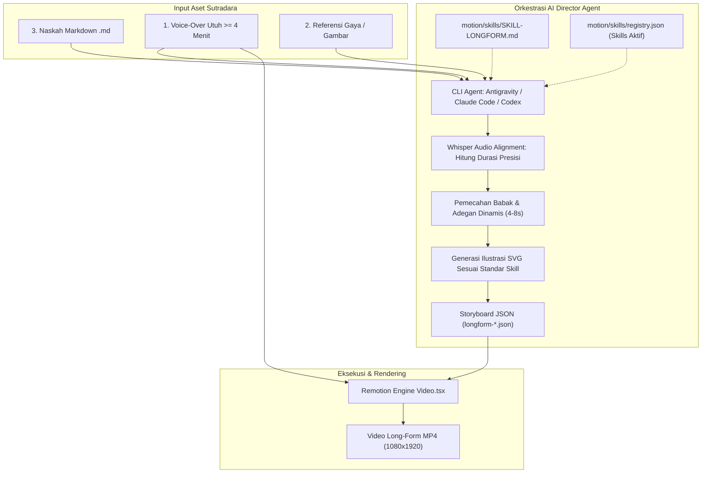

# Alur Kerja Pipeline & Arsitektur Sistem (Cheat Clip and Motion)

> Dokumentasi teknis komprehensif yang memetakan keterhubungan ekosistem **Motion Standar**, **Studio Animasi Bergerak (Native Remotion)**, **Motion Pro**, dan **Tools Ekstrak Gaya Video** dari hulu ke hilir (End-to-End Pipeline A sampai Z).

---

## 1. Arsitektur Umum & Ekosistem Sistem

Aplikasi ini menggabungkan mesin rendering video deterministik berbasis **React Remotion** dengan kapabilitas pemrosesan AI (CLI Agent dan script otomatis Python) yang berjalan **100% lokal** di komputer pengguna.

Ekosistem terbagi menjadi empat pilar fungsional yang saling terhubung:

---

## 2. Deep-Dive Pipeline: Ekstraksi Gaya Video (A sampai Z) — Chunked Analysis & AI Merger

Pipeline ini memungkinkan video referensi dari platform apa pun (seperti video TikTok, Reels, atau YouTube Shorts) dibedah DNA visual dan ritme editing-nya secara bertahap (**Time-Sliced Chunking per 8 Detik**) lalu disintesis oleh AI Agent (**The Merger Phase**) menjadi **Remotion Template baru** dan **AI Skill baru ready-to-use**.

### Tahapan Rinci:

#### 1. Input & Konfigurasi Chunking
- Pengguna memilih file video (`.mp4`, `.mov`, `.webm`) melalui drag-and-drop di tab **Ekstrak Gaya**.
- **Pemilihan Ukuran Potongan Waktu (Chunking):** Default 8 Detik (Rekomendasi Standar), dengan opsi 6 Detik (Super Mikro) atau 12 Detik (Video Panjang).
- **Pemilihan Kategori:** Pengguna memilih antara:
  - **🎬 Animasi Bergerak (Karakter & 3D Cel-Shaded):** Template dialokasikan ke `motion/src/presets_animasi/` untuk engine Studio Animasi.
  - **🖼️ Grafis Statis (SVG & Motion Grafis):** Template dialokasikan ke `motion/src/presets/` untuk engine Motion Standar.
- Sistem menghasilkan saran slug otomatis dari nama file (misal: `toon-3d-celshaded`).
- File dikirim ke backend `/api/ekstrak-gaya-video` dengan parameter `chunk_sec`.

#### 2. Segmentasi Waktu & Analisa Mikro Per Segmen (Step 1 .. N)
- Video dipotong secara logis menjadi $N = \lceil \text{durasi} / \text{chunk\_sec} \rceil$ segmen waktu.
- Untuk setiap segmen:
  - Mendeteksi titik pergantian adegan lokal menggunakan filter `gt(scene, 0.30)` FFmpeg.
  - Menghitung kecepatan pacing lokal per detik.
  - Mengambil frame representatif di titik $\approx 40\%$ durasi segmen.
  - Mengekstrak 5 warna HEX lokal via kuantisasi MedianCut Pillow.
  - Menyimpan thumbnail 9:16 per segmen di `studio/aset/gaya/segments/<slug>_step_XX.jpg`.
  - Menyimpan file data segmen `tmp_style_frames/<slug>/segments/step_XX/step_metrics.json`.

#### 3. Konsolidasi & Penggabungan AI Agent (The Merger Phase)
- AI Agent membaca kesepuluh (atau $N$) file data segmen:
  - **Master Palette Selection:** Memilih 5 warna HEX master yang paling harmonis dan konsisten antar-segmen (background, text/stroke, secondary, accent 1, accent 2).
  - **Overall Pacing:** Menghitung rata-rata pacing tertimbang seluruh video.
  - **Cover Poster Utama:** Memilih frame paling dinamis dari step tengah dan menyalinnya ke `studio/aset/gaya/<slug>.jpg`.
  - **Segment Recap:** Menyusun metadata `segment_analysis` lengkap untuk antarmuka pengguna dan dokumentasi skill.

#### 4. Generasi Artefak Skill & Remotion Preset
- Menghasilkan `motion/skills/<slug>/SKILL.md` dengan Bagian 6 (Tabel Analisis Multi-Segmen Video Referensi).
- Menghasilkan komponen preset React Remotion di `motion/src/presets/<slug>.tsx`.
- Memperbarui `motion/src/presets/index.ts` dan `motion/skills/registry.json`.
- Template baru langsung otomatis aktif di tab Motion, Motion Pro, dan Studio Animasi.

#### 2. Analisis Visual & Pacing (`scripts/extract_video_style.py`)
- **Pendeteksian Pacing:** `ffprobe` membaca metadata durasi, lalu `ffmpeg` mengeksekusi filter `select='gt(scene,0.35)'` untuk mendeteksi setiap cut pergantian scene. Rata-rata durasi per adegan dihitung (`avg_pacing_sec = total_durasi / scene_count`).
- **Kuantisasi Warna 5 HEX:** Keyframe representatif diambil dan digabungkan menjadi kanvas analisis warna menggunakan modul MedianCut Pillow untuk mengekstrak 5 warna HEX yang paling kontras dan berkarakter (Background utama, teks kontras, warna kontainer, aksen primer, dan aksen sekunder).
- **Auto-Capture Thumbnail 9:16:** Mengambil 1 screenshot terbaik dari adegan aktif video, di-center crop ke rasio 9:16 (270 × 480 px), dan disimpan langsung ke `studio/aset/gaya/<slug>.jpg`.
- **Output:** Menghasilkan file manifest DNA visual di `tmp_style_frames/<slug>/metrics.json`.
- **Pembersihan Otomatis:** Jika flag `--purge` aktif, video mentah langsung dihapus dari disk.

#### 3. Pembuatan Artefak Global (`scripts/generate_style_artifacts.py`)
- **Global AI Skill (`motion/skills/<slug>/SKILL.md`):**
  - Dilengkapi frontmatter YAML valid (`name`, `description`).
  - Berisi petunjuk pacing ketat untuk AI Director.
  - Memuat 5 palet warna HEX wajib yang harus diisi di `naskah.json`.
  - Memuat standar baku ilustrasi SVG aman (tanpa tag `<script>` atau event handler `on*` agar 100% lolos verifikasi `svg-aman.mjs`).
  - Aturan teks layar (maksimal kata judul) dan fisika pegas Remotion.
- **Preset Komposisi Remotion Sesuai Kategori:**
  - Kategori **Animasi Bergerak**: Menghasilkan `motion/src/presets_animasi/<slug>.tsx` yang menyertakan konfigurasi rig karakter bergerak, proporsi cel-shading, dan dynamic lighting.
  - Kategori **Grafis Statis**: Menghasilkan `motion/src/presets/<slug>.tsx` dengan komponen latar dinamis React berbasis kode SVG dengan palet warna ekstraksi.
- **Pembaruan Dynamic Registry (`motion/src/presets/index.ts`):**
  - Otomatis menyisipkan baris `import { preset_<slug> } from './<slug>';` dan meregistrasikannya ke dalam objek `STYLE_PRESETS`.
- **Pembaruan Global Skill Manifest (`motion/skills/registry.json`):**
  - Menyimpan entri `{ slug, name, description, kategori, palette_hex, avg_pacing_sec, thumbnail, created_at, inti: false }`.

#### 4. Distribusi & Tampilan di Antarmuka Studio
- **Sinkronisasi Tab Motion & Studio Animasi (`sinkronGayaMotion`):**
  - Frontend memanggil `/api/daftar-skills-global`.
  - Kartu template baru disisipkan secara dinamis di **urutan teratas** grid template tab terkait (`#pilGaya`).
  - Kartu menampilkan gambar screenshot `studio/aset/gaya/<slug>.jpg`, label badge `Animasi` atau `Statis`, dan counter template bertambah otomatis.
- **Sinkronisasi Tab Motion Pro:**
  - Card 4 ("Skills & Plugin Eksternal") langsung menampilkan badge skill baru tersebut sehingga siap dipanggil oleh AI Director Agent.
- **Pustaka di Tab Ekstrak Gaya:**
  - Kolom kanan menampilkan filter kategori (Semua, Animasi Bergerak, Grafis Statis), palet warna interaktif, dan tombol hapus jika tidak lagi digunakan.

---

## 3. Deep-Dive Alur: Studio Animasi Bergerak (Plan B - Native Remotion)

Modul **Studio Animasi Bergerak** adalah mesin animasi vertikal 9:16 yang mengeksekusi karakter bergerak, berjalan, dan berbicara secara deterministik di bawah **600 MB RAM** tanpa ketergantungan pada headless browser Playwright/Chromium yang berat.

### 3 Rig Karakter Utama:
1. **Toon 3D (Perspektif & Cel-Shaded):**
   - Karakter kartun modern dengan proporsi dinamis, stroke tebal, dan kedalaman cel-shading.
   - Sesuai dengan spesifikasi visual di [`contohgayavisual.md`](contohgayavisual.md).
2. **Stickman (Kinetik Jalan & Lari):**
   - Karakter figur garis minimalis dengan artikulasi sendi lincah dan rotasi anggota tubuh fluid.
3. **Isometric (3D Reka & Tech Grid):**
   - Proyeksi 30 derajat ortografis dengan blok 3D dan bayangan sudut datar untuk infografis data.

---

## 4. Deep-Dive Alur: Monitor Kuota Realtime Antigravity CLI

Studio terhubung secara lokal dengan daemon Language Server Google Antigravity untuk menampilkan kuota token langsung:

---

## 5. Deep-Dive Alur: Motion Standar (Short-Form Video)

Modul **Motion Standar** dirancang untuk memproduksi video pendek animasi berorientasi vertikal 9:16 (1080 × 1920) secara cepat:

1. **Pemilihan Gaya:** Pengguna memilih salah satu dari 24 template bawaan atau template kustom hasil ekstraksi video di grid `#pilGaya`.
2. **Pembangkitan Naskah (`motion/naskah.mjs`):** AI (Gemini / Claude / Ollama) menyusun naskah per adegan berstruktur JSON (`judul`, `teks`, `kunci`, `ikon`, `durasi`).
3. **Penyintesis Suara:** Suara narator dihasilkan per adegan (`public/suara/*.wav`) dan panjang suara diukur otomatis sebagai durasi adegan.
4. **Ilustrasi SVG Otomatis (`motion/gambar.mjs`):** AI menggambar objek SVG untuk memperkaya visual adegan, lalu diaudit oleh `motion/svg-aman.mjs` agar bebas dari script berbahaya.
5. **Rendering Dinamis (`motion/src/Video.tsx`):**
   - Remotion membaca properti `gaya`.
   - Fungsi `temaDari(p)` mencari preset di `STYLE_PRESETS[p.gaya] ?? TEMA[p.gaya] ?? STYLE_PRESETS['garis']`.
   - Video dirender menjadi file MP4 beresolusi 1080 × 1920 pada 30 fps di folder `hasil/`.

---

## 6. Deep-Dive Alur: Motion Pro (Long-Form Video $\ge 4$ Menit)

Modul **Motion Pro** adalah workspace khusus sutradara video panjang berdurasi 4 hingga 15+ menit berbasis integrasi CLI AI Agent resmi:

1. **Aset Utama:**
   - **Voice-Over:** Audio narasi utuh tanpa jeda musik yang sudah direkam/disintesis.
   - **Naskah Markdown:** Naskah terstruktur per babak dan adegan.
   - **Gambar Referensi:** Panduan visual agar karakter dan objek konsisten.
2. **Koneksi CLI AI Agent:**
   - Tidak menggunakan API Key langsung, melainkan mengeksekusi CLI resmi langganan pengguna (`antigravity`, `claude`, `codex`, atau `opencode`).
   - Agent membaca aturan sutradara dari `motion/skills/SKILL-LONGFORM.md` dan modul-modul skill aktif yang terdaftar di `motion/skills/registry.json`.
3. **Penyusunan Storyboard & Keamanan:**
   - Agent melakukan chunking adegan agar setiap potongan adegan berdurasi 4–8 detik dengan pergantian visual dinamis (mencegah penonton bosan).
   - Seluruh grafis vektor SVG disaring dengan `motion/svg-aman.mjs`.
4. **Rendering Panjang:**
   - Storyboard disimpan ke `motion/naskah/longform-<timestamp>.json`.
   - Audio narasi utuh dipasang langsung via properti `audioNarasi`, sementara visual adegan bergerak secara sinkron di timeline Remotion.

---

## 7. Ringkasan File & Direktori Inti

| Direktori / File | Peran Utama |
|---|---|
| `studio/studio.py` | Server backend lokal, router API (`/api/ekstrak-gaya-video`, `/api/antigravity/kuota`, `/api/daftar-skills-global`, dll.), serta runner proses CLI. |
| `studio/index.html` | Antarmuka pengguna (SPA), mencakup Beranda, Klip, Motion, Studio Animasi, Motion Pro, dan Tools Ekstrak Gaya. |
| `scripts/extract_video_style.py` | Engine ekstraksi visual video (scene detection, 5 palet HEX, capture thumbnail 9:16). |
| `scripts/generate_style_artifacts.py` | Generator artefak otomatis (`SKILL.md`, `preset.tsx`, registrasi `index.ts`, dan `registry.json`). |
| `studio/aset/gaya/<slug>.jpg` | Folder thumbnail visual 9:16 untuk kartu template di tab Motion dan Ekstrak Gaya. |
| `motion/skills/` | Modul keahlian AI (skill bawaan + skill baru hasil ekstraksi video referensi). |
| `motion/skills/registry.json` | Manifest global seluruh skill yang terdaftar di sistem. |
| `motion/src/presets/` | Folder komponen preset komposisi Remotion grafis statis. |
| `motion/src/presets_animasi/` | Folder komponen preset khusus Studio Animasi Karakter Bergerak. |
| `motion/src/presets/index.ts` | Indeks sentral yang mengekspor seluruh preset ke `STYLE_PRESETS`. |
| `motion/src/Video.tsx` | Komposisi inti Remotion untuk Motion Standar & Long-Form. |
| `motion/src/VideoAnimasi.tsx` | Komposisi Native Remotion untuk Studio Animasi Bergerak (RAM < 600 MB). |
| `motion/src/Akar.tsx` | Registrasi Root komposisi Remotion (`Video` dan `AnimasiBergerak`). |
| `docs/workflow_animasi_karakter_bergerak.md` | Dokumentasi arsitektur dan alur kerja teknis Studio Animasi Bergerak. |
| `motion/svg-aman.mjs` | Filter validator keamanan SVG (mencegah `<script>` dan atribut event). |
| `studio/index.html#h-faq` | Halaman Tutorial Penggunaan, FAQ terstruktur (Motion, Motion Pro, Ekstrak Gaya, AI Quota), dan integrasi bantuan resmi via WhatsApp (`wa.me/6283862300495`). |

---

## 8. Pusat Bantuan & Kontak WhatsApp Resmi

Untuk kebutuhan:
1. **Otorisasi Kode Akses Motion Pro**: Aktivasi workspace video panjang $\ge 4$ menit.
2. **Request Template Remotion Kustom**: Pembuatan preset animasi khusus.
3. **Troubleshooting & Tanya Jawab Teknis**: Bantuan konfigurasi AI CLI, Remotion, dan audio.

Hubungi admin/developer langsung melalui WhatsApp resmi:  
👉 **[WhatsApp Admin: +62 838-6230-0495 (wa.me/6283862300495)](https://wa.me/6283862300495?text=Halo%20Admin%20Cheat%20Clip%20%26%20Motion,%20saya%20ingin%20akses%20Motion%20Pro%20dan%20ada%20pertanyaan)**

---

## 9. Integrasi Canvas Gemini: Generator Naskah, TTS & Visual Bible

Penyusunan naskah video pendek terhubung langsung dengan aplikasi Canvas Gemini:  
🌐 **Akses Tool Canvas:** [Generator Naskah Video Pendek & TTS (share.gemini.google/NFulYmtV6Anl)](https://share.gemini.google/NFulYmtV6Anl)

### Alur Kerja Naskah ke Storyboard:
1. **Perancangan di Canvas Gemini:** Pengguna memilih niche/topik, mode narator (1 Narator vs Dialog), alur perpindahan latar tempat, dan ciri fisik tokoh.
2. **Ekspor Format:**
   * **Format 1:** Naskah berformat `[ADEGAN X | LATAR: ...]`
   * **Format 2:** Naskah bersih siap baca untuk mesin suara TTS (ElevenLabs / Google AI Studio).
   * **Format 3:** Visual Bible penentu konsistensi pakaian tokoh & pencahayaan.
   * **Format 4:** Manifest Storyboard JSON deterministik (`adegan_storyboard`).
3. **1-Klik Impor ke Studio:** Di tab Motion Studio, klik tab **📥 Impor dari Canvas Gemini (1-Klik)**, tempelkan teks Format 1 atau JSON Format 4, lalu klik **⚡ Terapkan Naskah**. Daftar adegan, latar, dan dialog langsung terisi instan tanpa konfigurasi manual.

---

## 10. Live Floating Diagnostic Console & Status Monitor

Studio dilengkapi konsol diagnostik mengambang di pojok kanan bawah:
* **Indikator Live:** Menampilkan dot indikator hijau (`IDLE`), biru berdenyut (`RUNNING`), atau merah (`ERROR`).
* **Penerjemah Bahasa Manusia:** Mengonversi error teknis (API key, durasi audio melebihi naskah, memori) menjadi rekomendasi solusi praktis.
* **Non-Intrusif:** Tidak memunculkan popup merah mendadak saat awal startup, dan hanya aktif ketika proses render sungguhan mengalami kendala.

