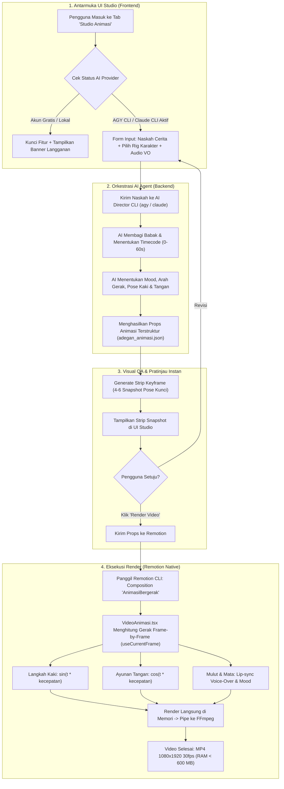

# Workflow: Studio Animasi Karakter Bergerak (Plan B - Native Remotion)
> **Dokumen Alur Kerja Teknis & Eksekusi (*Workflow Document*)**  
> **Status:** Draft untuk Peninjauan (*Review & Input*)  
> **Target Implementasi:** Cheat Clip & Motion Pro  
> **Mesin Render:** Remotion Native Canvas (`motion/src/VideoAnimasi.tsx`)  
> **Mesin Penalaran:** Antigravity CLI (`agy`) / Claude Code CLI (`claude`)

---

## 1. Diagram Alur Kerja Keseluruhan (*End-to-End Architecture*)



---

## 2. Rincian Langkah Kerja (*Step-by-Step Breakdown*)

### Tahap 1: Validasi Akses & Provider AI (*Subscription Gatekeeper*)
1. Saat tab **Studio Animasi** dibuka, sistem UI memeriksa konfigurasi provider AI yang aktif di backend (`studio/studio.py`):
   - Jika pengguna memilih **AI: Lokal / Gratis**, panel animasi otomatis terkunci dengan pesan:
     > *"Fitur Animasi Karakter Bergerak memerlukan kapabilitas penalaran tingkat tinggi. Hubungkan langganan Antigravity CLI (`agy`) atau Claude Code CLI (`claude`) pada Pengaturan AI."*
   - Jika pengguna memilih **Antigravity CLI** atau **Claude Code CLI**, seluruh kontrol studio animasi aktif.

### Tahap 2: Input Kreatif Pengguna (Bebas JSON)
Pengguna tidak perlu lagi mengetik atau menempelkan struktur data JSON yang rumit. Cukup mengisi 3 elemen visual:
1. **Naskah Cerita / Penjelasan (Markdown/Teks Biasa):**
   - Menulis cerita per paragraf atau poin-poin ide.
2. **Pilihan Rig Karakter & Gaya Visual:**
   - Kartu pilihan visual:
     - 🎭 **Toon 3D Explainer** (Karakter kartun perspektif 3D, gestur tangan, ekspresi dinamis).
     - 🏃 **Stickman Kinetic** (Stickman gerak cepat dengan latar kota/kantor, walk & run cycle).
     - 📐 **Isometric Engine** (Pemandangan isometrik 3D, elemen mesin, alur kerja teknologi).
     - ➕ **Gaya Kustom dari Analisis Video** (Hasil ekstraksi video referensi yang diunggah pengguna).
3. **Audio Voice-Over:**
   - Tombol satu-klik untuk sintesis suara otomatis (Edge TTS / SAPI / VoxCPM) atau upload audio rekaman sendiri.

### Tahap 3: Orkestrasi AI Agent (*Storyboarding & Rig Coordination*)
AI Agent (Antigravity atau Claude) memproses naskah dalam format nalar tinggi:
1. **Segmentasi Waktu (Timecode Mapping):** Menyesuaikan tiap kalimat naskah dengan durasi audio voice-over (misal: Kalimat 1 = detik 00:00 - 00:04).
2. **Penentuan Koreografi & Aksi Karakter:**
   - Adegan 1: Karakter berjalan masuk dari kiri ke tengah (`action: "walk_in"`, `speed: 1.2`).
   - Adegan 2: Karakter berhenti, menghadap kamera, menunjuk ke diagram (`action: "present_point"`, `expression: "excited"`).
   - Adegan 3: Karakter berpikir/bingung (`action: "ponder"`, `expression: "confused"`).
3. Output disimpan sebagai konfigurasi internal tanpa mengekspos kerumitan kode kepada pengguna biasa.

### Tahap 4: Pratinjau Visual QA Keyframe (Pencegah Salah Render)
Untuk menghemat waktu dan daya komputer:
1. Sistem mengambil **4–6 snapshot kunci** di detik-detik penting (misal: detik 0, detik 10, detik 25, detik 45).
2. Snapshot ditampilkan dalam bentuk *Keyframe Filmstrip* horizontal di UI.
3. Pengguna dapat langsung melihat apakah pose karakter, ekspresi wajah, dan teks keterangan sudah pas sebelum menekan tombol render final.

### Tahap 5: Native Remotion Rendering (`motion/src/VideoAnimasi.tsx`)
1. Backend menjalankan perintah render:
   ```bash
   npx remotion render src/index.ts AnimasiBergerak hasil/video_animasi.mp4 --props=./tmp/props_animasi.json
   ```
2. **Keunggulan Plan B (Hemat RAM & Cepat):**
   - Tidak ada 4 jendela browser Chromium Playwright terpisah.
   - Tidak ada penulisan 1.800–6.000 file gambar PNG ke harddisk/SSD.
   - Seluruh matematika gerak dihitung langsung per frame menggunakan fungsi deterministik di memori Remotion:
     $$\text{Posisi Lutut}(t) = \sin(t \times \omega) \times A$$
     $$\text{Bukaan Mulut}(t) = |\sin(t \times \omega_{\text{bicara}})| \times \text{Volume}$$
   - Konsumsi RAM stabil di bawah **600 MB** dan video MP4 siap dalam 1–2 menit.

---

## 3. Perbandingan Beban Sistem: Plan A vs Plan B

| Parameter Evaluasi | Plan A (Playwright Multi-Chromium) | Plan B (Remotion Native `VideoAnimasi.tsx`) |
|---|---|---|
| **Penggunaan RAM** | 🔴 2.5 GB – 3.8 GB (Sangat boros, rawan *freeze*) | 🟢 **300 MB – 600 MB (Sangat ringan & stabil)** |
| **Beban Harddisk / SSD** | 🔴 Menulis ribuan file PNG temporer (2–5 GB) | 🟢 **0 file sampah (Direct stream memory to MP4)** |
| **Kecepatan Render** | 🟡 Tergantung IO disk dan sinkronisasi 4 browser | 🟢 **Deterministik & teroptimasi oleh compiler Remotion** |
| **Kebutuhan Dependensi** | 🔴 Wajib install browser Playwright terpisah | 🟢 **Cukup dependensi Remotion yang sudah ada di proyek** |
| **Kemudahan Maintenance** | 🟡 Logika tersebar di skrip Node eksternal | 🟢 **Tersentralisasi dalam komponen React TypeScript** |

---

## 4. Rencana Implementasi Bertahap (*Phased Execution Plan*)

1. **Fase 1: Tinjauan & Penyetujuan User (Langkah Saat Ini)**
   - Mendengarkan masukan pengguna terkait dokumen PRD dan Workflow ini.
2. **Fase 2: Pembuatan Komponen Inti Remotion**
   - Menulis `motion/src/VideoAnimasi.tsx` yang memuat pustaka rig karakter (Toon 3D, Stickman, Isometric).
   - Mendaftarkan komposisi `AnimasiBergerak` di `motion/src/Akar.tsx`.
3. **Fase 3: Rombak Antarmuka UI Studio**
   - Mengganti textarea "Tempel Naskah JSON" di `studio/index.html` dengan antarmuka **Studio Animasi Karakter**.
   - Menambahkan pengecekan status AI berlangganan (AGY / Claude Code).
4. **Fase 4: Integrasi Backend & Pengujian Visual QA**
   - Menghubungkan tombol "Buat Animasi" ke backend `studio/studio.py`.
   - Menguji alur pembuatan video dari naskah teks polos hingga menjadi MP4 1080×1920 yang bergerak hidup.


